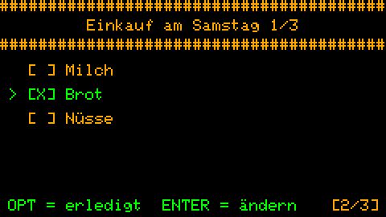
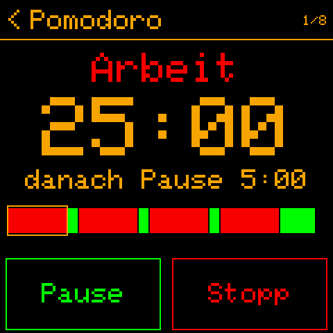

# 🐿️ Squirrel!

**Ein elektronischer Assistent mit großem Herzen und buschigem Schwanz, der in die Hosentasche passt - und ans
Handgelenk.**

*[English](README.md) · [Polski](README_pl.md) · [Français](README_fr.md) · Deutsch*

---

Squirrel! braucht kein Handy, kein Internet, keine Cloud und keine KI. Vor allem stiehlt es dir nicht mit tausend
Benachrichtigungen die Aufmerksamkeit - so wie es dein Smartphone sonst tut.

Eichhörnchen sollen ein furchtbares Gedächtnis haben. Squirrel! hat Gedächtnis für zwei. Es merkt sich, was du sonst
vergisst, erinnert dich sanft, wenn du abdriftest, und freut sich mit dir, wenn du es schaffst. Es seufzt nie, zählt
nicht, wie oft du dasselbe gefragt hast, und zeigt dir nie eine rote Serie. Es kommt einfach jeden Tag wieder, bereit
zu helfen.

Es ist gemacht für Menschen mit ADHS, Zeitblindheit und exekutiver Dysfunktion - und für alle, die ein ruhiges,
geduldiges Werkzeug brauchen, bei dem man sich nicht schlecht fühlt, *„weil man hinterherhängt“*.

 

## Was es anders macht

- **Keine Strafe fürs Verpassen.** Du verpasst deine Morgenroutine - nichts wird rot, keine Serie beginnt von vorn.
  Morgen wartet die Routine auf dich, unverändert, ohne Kommentar.
- **Ruhig gemacht.** Keine Pop-ups, keine Abzeichen, kein visueller Lärm. Was du brauchst, ist auf dem Bildschirm; der
  Rest bleibt aus dem Weg.
- **Erinnerungen nach deinen Regeln.** So viele Routinen, wie du brauchst, ein Kuckuck jede Stunde und, wenn du willst,
  jede Viertelstunde - oder Stille, nachts oder wann du willst.
- **Offline und deins.** Kein Konto, kein Abo, keine Cloud. Notizen und Aufgaben sind einfache Dateien auf deinem
  Gerät; Funk gibt es nur für die Bluetooth-Synchronisation zwischen deinen eigenen gekoppelten Geräten und WLAN für
  die Uhrzeit.
- **Nichts funktioniert? Auch das ist okay.** Probier die Werkzeuge aus und behalte, was **für dich** funktioniert.

## Was es kann

| | |
|---|---|
| 🕐 **Uhr** mit Akku und heutigem Fokus als Balken | 🧠 **Gedankenablage** - ein Gedanke in Sekunden aus dem Kopf |
| ✅ **Aufgaben und Checklisten**, die nicht urteilen | 🎙️ **Sprachnotizen** auf einen Knopfdruck |
| 📋 **Textnotizen**, einfache `.txt`-Dateien | 🔄 **Routinen** ohne Serie, die man verlieren kann |
| 🦅 **Kuckucksuhr** gegen Zeitblindheit | 🍅 **Pomodoro und Training** im Hintergrund |
| 🥁 **Metronom** und 🫁 **Atmung** | 📊 **Statistik** - ein ruhiges Bild deiner Tage |
| 🔗 **Bluetooth-Synchronisation** deiner Geräte | 🌍 **English, Polski, Français, Deutsch** |

 

Bildschirm für Bildschirm: [Funktionen](docs/guides/de/features.md) · die Tasten: [Tastenkürzel](docs/guides/de/shortcuts.md).

## Geräte

| Gerät | |
|---|---|
| **M5Stack Cardputer ADV** | der Taschencomputer mit Tastatur - das Haupt-Squirrel!, auf dem du schreibst |
| **LilyGo T-Watch 2020 V3** | am Handgelenk: liest und hakt ab, was der Cardputer ihr gibt, Routinen und Timer, Vibration |
| **M5Stack Cardputer** (der erste) | *experimentell*, noch nicht auf einem Gerät ausprobiert: dasselbe Squirrel! wie auf dem ADV, ohne Summer |
| **ESP32-S3-Smartwatches** | *experimentell*, noch nicht auf einem Gerät ausprobiert |

## Erste Schritte

```bash
git clone https://github.com/aparatowo/Squirrel.git
cd "Squirrel/Squirrel!"
python3 build_firmware.py --install-idf                     # once
python3 build_firmware.py --flash /dev/ttyACM0              # Cardputer ADV
python3 build_firmware.py --port twatch2020_v3 --flash /dev/ttyACM0     # T-Watch 2020 V3
python3 build_firmware.py --port cardputer --flash /dev/ttyACM0         # Cardputer (the first one)
```

Alle Schritte: [Erste Schritte](docs/guides/de/getting-started.md).

## Mehr dazu

- **Für Nutzer:** [Erste Schritte](docs/guides/de/getting-started.md) · [Funktionen](docs/guides/de/features.md) ·
  [Tastenkürzel](docs/guides/de/shortcuts.md) · [Bluetooth-Synchronisation](docs/guides/de/bluetooth.md)
- **Neuigkeiten:** [Versionshinweise](docs/releases/README.md) - Version 2.0: Bluetooth-Synchronisation, vier
  Sprachen, Checklisten
- **Für Entwickler:** [Bauen](docs/implementation/de/building.md) · [Ports](docs/implementation/de/ports.md) ·
  [alle Dokumente](docs/README.md)
- **Übersetzen:** [Squirrel!/translations](Squirrel!/translations/README.md)
- **[Vom Autor](docs/author/de.md)** - warum es Squirrel! gibt

---

Squirrel! läuft auf MicroPython. Open Source (MIT, [LICENSE.txt](LICENSE.txt); Teile Dritter:
[THIRD_PARTY_NOTICES.md](THIRD_PARTY_NOTICES.md)). Mit Sorgfalt gebaut. Frei geteilt.
