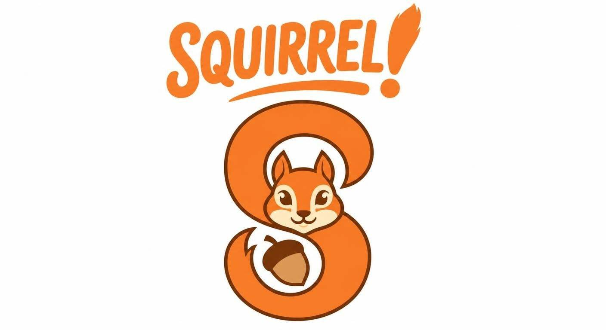
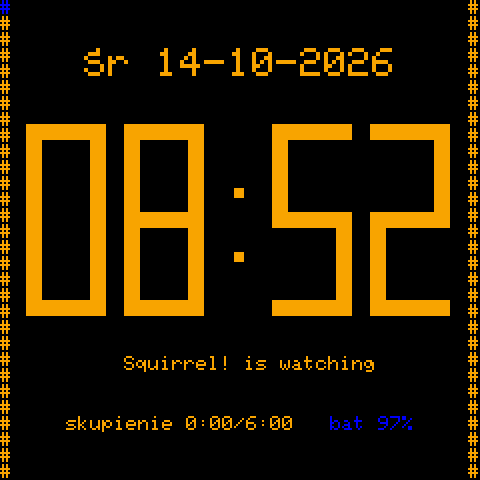
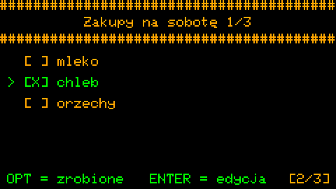
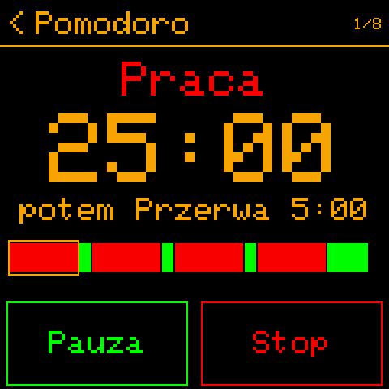

# 🐿️ Squirrel!

**Elektroniczny asystent o wielkim sercu i puchatym ogonie, który mieści się w kieszeni - i na nadgarstku.**

*[English](README.md) · Polski · [Français](README_fr.md) · [Deutsch](README_de.md)*

---

Squirrel! nie potrzebuje telefonu, internetu, chmury ani AI. Najważniejsze jednak, że nie kradnie Twojej uwagi
tysiącem powiadomień, którymi zwykle smartfon kradnie Ci czas i skupienie.

Podobno wiewiórki mają wyjątkowo słabą pamięć. Squirrel! ma pamięć za dwóch. Pamięta o tym, o czym zwykle zapominasz.
Delikatnie przypomina, gdy odpływasz, i świętuje z Tobą, gdy dajesz radę. Nigdy nie wzdycha. Nie liczy, ile razy
pytałeś o to samo. Nie pokazuje czerwonych statystyk. Po prostu wraca każdego dnia, gotowy do pomocy.

Powstał z myślą o osobach z ADHD, ślepotą czasową i dysfunkcją wykonawczą - i dla każdego, kto potrzebuje spokojnego,
cierpliwego narzędzia, które nie sprawia, że czujesz się źle, *"bo mam tyły"*.

 

## Co go wyróżnia

- **Brak kary za pominięcie.** Pominiesz poranną rutynę - nic nie robi się czerwone, żaden streak się nie resetuje.
  Jutro rutyna na Ciebie czeka, bez komentarza, bez zmiany.
- **Spokój z założenia.** Żadnych wyskakujących okienek, plakietek ani wizualnego hałasu. To, czego potrzebujesz, jest
  na ekranie - reszta jest z dala.
- **Przypomnienia na Twoich zasadach.** Tyle rutyn, ile potrzebujesz, kukułka co godzinę, a jeśli chcesz, to i co
  kwadrans - albo cisza, w nocy lub kiedy zechcesz.
- **Offline i Twój.** Bez konta, subskrypcji i chmury. Notatki i zadania to zwykłe pliki na Twoim urządzeniu; radio
  służy tylko synchronizacji Bluetooth między Twoimi sparowanymi urządzeniami i Wi-Fi do ustawienia czasu.
- **Nic nie działa? To też jest OK!** Eksperymentuj z narzędziami i zostaw to, co działa **dla Ciebie**.

## Co potrafi

| | |
|---|---|
| 🕐 **Zegar** z belkami baterii i dzisiejszego skupienia | 🧠 **Mind dump** - myśl z głowy w kilka sekund |
| ✅ **Zadania i checklisty**, które nie oceniają | 🎙️ **Notatki głosowe** jednym przyciskiem |
| 📋 **Notatki tekstowe**, zwykłe pliki `.txt` | 🔄 **Rutyny** bez streaka do stracenia |
| 🦅 **Zegar z kukułką** na ślepotę czasową | 🍅 **Pomodoro i trening** w tle |
| 🥁 **Metronom** i 🫁 **oddychanie** | 📊 **Statystyki** - spokojny obraz Twoich dni |
| 🔗 **Synchronizacja Bluetooth** Twoich urządzeń | 🌍 **English, Polski, Français, Deutsch** |

 

Ekran po ekranie: [funkcje](docs/guides/pl/features.md) · klawisze: [skróty](docs/guides/pl/shortcuts.md).

## Urządzenia

| Urządzenie | |
|---|---|
| **M5Stack Cardputer ADV** | kieszonkowy komputer z klawiaturą - główny Squirrel!, na nim piszesz |
| **LilyGo T-Watch 2020 V3** | na nadgarstku: czyta i odhacza to, co dostał od Cardputera, rutyny i timery, wibracje |
| **M5Stack Cardputer** (pierwszy) | *eksperymentalnie*, jeszcze niesprawdzony na urządzeniu: ten sam Squirrel! co na ADV, bez brzęczyka |
| **Smartwatche z ESP32-S3** | *eksperymentalnie*, jeszcze niesprawdzone na urządzeniu |

## Pierwsze kroki

```bash
git clone https://github.com/aparatowo/Squirrel.git
cd "Squirrel/Squirrel!"
python3 build_firmware.py --install-idf                     # once
python3 build_firmware.py --flash /dev/ttyACM0              # Cardputer ADV
python3 build_firmware.py --port twatch2020_v3 --flash /dev/ttyACM0     # T-Watch 2020 V3
python3 build_firmware.py --port cardputer --flash /dev/ttyACM0         # Cardputer (the first one)
```

Wszystkie kroki: [pierwsze kroki](docs/guides/pl/getting-started.md).

## Więcej

- **Dla użytkowników:** [pierwsze kroki](docs/guides/pl/getting-started.md) · [funkcje](docs/guides/pl/features.md) ·
  [skróty](docs/guides/pl/shortcuts.md) · [synchronizacja Bluetooth](docs/guides/pl/bluetooth.md)
- **Co nowego:** [informacje o wydaniach](docs/releases/README.md) - wersja 2.0: synchronizacja Bluetooth, cztery
  języki, checklisty
- **Dla programistów:** [budowanie](docs/implementation/pl/building.md) · [porty](docs/implementation/pl/ports.md) ·
  [wszystkie dokumenty](docs/README.md)
- **Tłumaczenia:** [Squirrel!/translations](Squirrel!/translations/README.md)
- **[Od autora](docs/author/pl.md)** - po co powstał Squirrel!

---

Squirrel! działa na MicroPythonie. Open source (MIT, [LICENSE.txt](LICENSE.txt); części innych autorów:
[THIRD_PARTY_NOTICES.md](THIRD_PARTY_NOTICES.md)). Zbudowany z troską. Udostępniony bezpłatnie.
