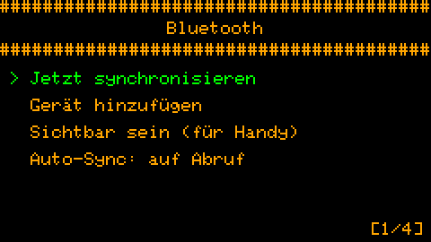
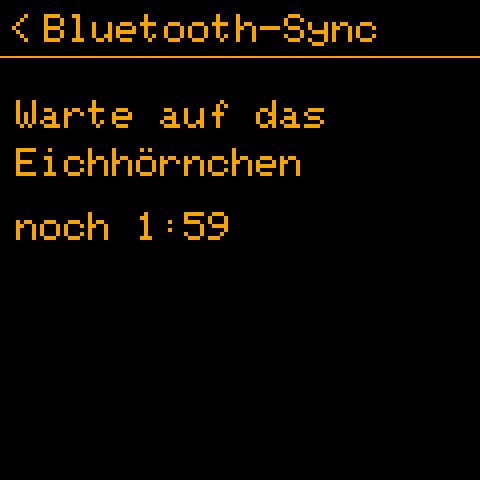

# Bluetooth-Synchronisation

*[English](../en/bluetooth.md) · [Polski](../pl/bluetooth.md) · [Français](../fr/bluetooth.md) · Deutsch*

Deine Squirrel!-Geräte halten sich gegenseitig über Bluetooth auf dem Laufenden. Version 2.0. Wie es gebaut ist (für
Entwickler): [implementation/de/bluetooth.md](../../implementation/de/bluetooth.md).

## Was wohin geht

Ein Gerät ist der **Chef** - der Cardputer: er hat die Tastatur, also wird der Inhalt dort geschrieben. Die anderen
sind **Knoten** - heute die Uhr.

| Was | Richtung |
|---|---|
| der Inhalt von Routinen, Aufgaben und Notizen | Chef → Knoten (der Chef ist der einzige Autor) |
| Haken: Aufgaben, Checklisten-Punkte, eine Routine an / aus | in beide Richtungen - die spätere Änderung gewinnt |
| das Routinen-Protokoll (erledigt / übersprungen / keine Antwort), die Statistik | Knoten → Chef, für jedes Gerät getrennt |
| Einstellungen: Kuckuck, Pomodoro, Trainingsplan, Ruhezeiten, Routinen-Pause, Auto-Sync | Chef → Knoten |
| die Uhrzeit | von der besseren Uhr zur schlechteren (WLAN-Zeit > Hardware-Uhr > von Hand gestellt) |

Was die Uhr hatte, bevor sie dazukam (per USB kopierte Aufgaben zum Beispiel), bleibt ihr eigenes: der Chef
überschreibt und löscht es nicht.

## Das erste Mal: koppeln

1. **Uhr:** *Einstellungen → Bluetooth* (oder auf der Uhr nach unten wischen) - sie wartet 2 Minuten auf den Chef.
2. **Cardputer:** *Einstellungen → Bluetooth → Gerät hinzufügen* - er sucht nach Geräten; ENTER auf der Uhr.
3. Die Uhr zeigt **6 Ziffern**; gib sie auf dem Cardputer ein und drück ENTER.

Der Code wird nur einmal gebraucht. Ein nicht gekoppeltes Gerät bekommt nichts und ändert nichts.

 

## Im Alltag

- **Schnell-Sync:** **Aa** auf der Uhr des Cardputers (oder TAB, dann S) synchronisiert jedes Gerät und kehrt zur Uhr
  zurück; auf der Uhr **nach unten wischen** - sie wartet auf den Cardputer und kehrt von selbst zurück.
- **Jetzt synchronisieren** in *Einstellungen → Bluetooth* tut dasselbe aus dem Menü; ENTER auf einem Gerät
  synchronisiert nur dieses, und die Liste zeigt, wann jedes synchronisiert wurde und was passiert ist.
- **Von selbst:** *Auto-Sync* in *Einstellungen → Bluetooth* (ENTER wechselt: auf Abruf, alle 15, 30, 60, 120 oder 240
  Minuten). Die Synchronisationen richten sich nach der Uhr - alle 60 Minuten heißt zu vollen Stunden - damit sich die
  Geräte treffen, ohne vorher zu reden: die Uhr wacht dafür sogar aus dem Tiefschlaf auf und lauscht 90 Sekunden; der
  Cardputer synchronisiert 20 Sekunden nach der vollen Stunde. Jede Synchronisation kostet die Uhr etwa 1 mAh (ihr
  Akku hat etwa 380).

## Die Statistik jedes Geräts

Der Cardputer behält die Statistik, die jedes Gerät gemeldet hat: in *Fokus → Statistik* zeigt LEFT / RIGHT dieses
Gerät, jedes synchronisierte oder alle zusammen.

## Routinen auf bestimmten Geräten

Mit synchronisierten Geräten hat eine Routine ein Feld *Geräte*: sie erscheint nur auf den angehakten. Alle angehakt
heißt jedes Gerät, auch die später hinzugefügten.

## Zeit von einem Gerät

*Einstellungen → Zeit und Datum → Zeit von einem Gerät*: der Cardputer nimmt die Zeit des ersten Geräts mit einer
gültigen Hardware-Uhr (die Uhr hat eine).

## Ein Handy oder ein Computer

[`Squirrel!/tools/web/squirrel_ble.html`](../../../Squirrel!/tools/web/squirrel_ble.html) ist eine Seite für Chrome oder
Edge, die über Web Bluetooth mit den Geräten spricht: mit dem Cardputer verbunden (*Einstellungen → Bluetooth →
Sichtbar sein*) bearbeitet sie Aufgaben, Checklisten, Routinen, Notizen und Einstellungen; mit der Uhr verbunden hakt
sie ab und schaltet Routinen; sie kann die Zeit vom Handy stellen. Sie koppelt mit demselben 6-stelligen Code. Wie man
sie öffnet: [tools/web/README.md](../../../Squirrel!/tools/web/README.md).

Auf einem Computer öffnet sich die Seite direkt aus dem Ordner, ohne Server (unter Linux braucht Chrome eine
eingeschaltete Flagge, siehe dieses README); ein Handy braucht sie unter einer `https://`-Adresse. **Eine Uhr merkt sich
eine Kopplung:** die Seite mit der Uhr zu koppeln lässt den Cardputer bei der nächsten Synchronisation nach einem neuen
Code fragen, und den Cardputer erneut zu koppeln lässt die Seite fragen. Die Seite mit dem Cardputer zu koppeln ändert
für die Uhr nichts.

## Ein Gerät vergessen

Auf dem Cardputer: *Einstellungen → Bluetooth*, das Gerät, **zweimal DEL**. Sein Schlüssel geht mit; es erneut
hinzuzufügen verlangt einen neuen Code.

## ⚠️ Was das Koppeln schützt, und was nicht

Ohne den Code kann niemand deine Geräte synchronisieren oder ändern. Aber die Datensätze selbst gehen
**unverschlüsselt** durch die Luft: jemand in der Nähe mit Bluetooth-Abhörgerät könnte sie während einer
Synchronisation **lesen** und den Schlüssel aus einer belauschten Kopplung zurückgewinnen (der Code hat nur 6
Ziffern). Koppele also nicht in der Nähe von Fremden, und halte Passwörter und sensible Daten aus synchronisierten
Aufgaben und Notizen heraus. Die Verschlüsselung der Verbindung selbst ist im Code fertig und wird eingeschaltet,
sobald sie genug getestet ist ([Backlog](../../implementation/de/backlog.md)).

## Wenn etwas nicht klappt

| Was du siehst | Was tun |
|---|---|
| *Keine Geräte - erst eins hinzufügen* | Erst die Uhr koppeln (oben). |
| *Fehler: keine Antwort* | Manchmal bekommt eine Synchronisation direkt nach dem Verbinden keine Antwort; der Cardputer versucht es im selben Durchgang noch einmal. Wenn es weiter scheitert, noch einmal *Jetzt synchronisieren*. |
| *Niemand kam* auf der Uhr | Der Cardputer hat sich nicht innerhalb von 2 Minuten verbunden: starte die Synchronisation dort, während die Uhr wartet. |
| Es wird wieder ein Code verlangt | Eines der Geräte hat die Kopplung vergessen (Reset, neue Daten), oder die Webseite wurde inzwischen mit der Uhr gekoppelt: gib den neuen Code ein. |
| Der Cardputer startet nach einer Minute von selbst neu | Sehr selten hängt er; ein Watchdog startet ihn neu, deine Daten bleiben ([Backlog](../../implementation/de/backlog.md), B). |
