# Funktionen

*[English](../en/features.md) · [Polski](../pl/features.md) · [Français](../fr/features.md) · Deutsch*

Was Squirrel! tut, Bildschirm für Bildschirm. Version 2.0. Die Tasten und Gesten für all das:
[Tastenkürzel](shortcuts.md). Bilder: der Cardputer links, die Uhr rechts (wo sie diesen Bildschirm hat).

---

## 🕐 Die Uhr

Der Startbildschirm ist eine Uhr: große Ziffern, das Datum und eine eigene Zeile unten (*no need to go nuts* auf dem
Cardputer, *Squirrel! is watching* auf der Uhr - in Anpassen änderbar, oder lass sie so). Die Balken an den Rändern
sind der Akku (links) und die heutige Fokuszeit im Verhältnis zu deinem Ziel (rechts). Die Uhr zeigt außerdem den
Wochentag und, in Worten, die Fokuszeit und den Akku - jedes in der Farbe seines Balkens.

 

Von der Uhr aus: jede Taste öffnet das Menü, **OPT** startet oder pausiert den Fokus-Timer, **Aa** synchronisiert
deine Geräte, **TAB** öffnet ein kleines Menü mit dem, was du am häufigsten brauchst:

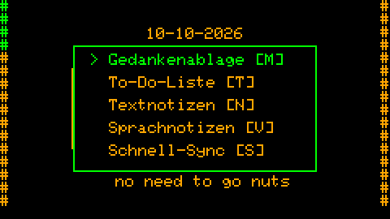

Die Zeit kommt von einer Hardware-Uhr, wenn es eine gibt (der PCF8563 der Uhr, ein optionaler DS1302 am Cardputer),
beim Start aus dem WLAN oder per Bluetooth von einem anderen Squirrel!-Gerät (*Einstellungen → Zeit und Datum → Zeit
von einem Gerät*).

## ✅ Aufgaben und Checklisten

Eine Liste von Dingen, die dich nicht verurteilt. Eine Aufgabe ist ein Titel und, wenn du willst, mehr Text. **OPT**
markiert sie als erledigt (auf der Uhr: gedrückt halten). Erledigte Aufgaben bleiben eine Woche (`TODO_KEEP_DAYS`),
dann verschwinden sie von selbst.

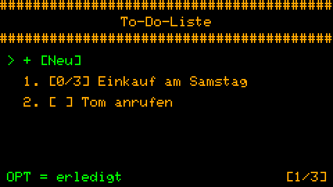 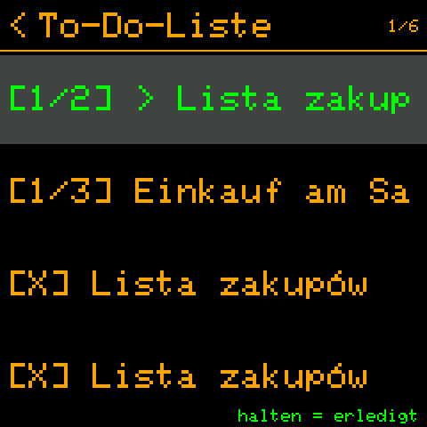

**Checklisten.** Zeilen, die mit `>` beginnen, sind Punkte zum Abhaken - eine Einkaufsliste, die Schritte einer
Aufgabe:

```
Einkauf am Samstag
> Milch
> Brot
> Nüsse
Tasche nicht vergessen
```

So eine Aufgabe öffnet sich als Checkliste; die Liste zeigt den Fortschritt (`[1/3]`); wenn alle Punkte abgehakt sind,
ist die ganze Aufgabe erledigt. Der Text der Datei ändert sich nie - die Haken werden getrennt gespeichert.

 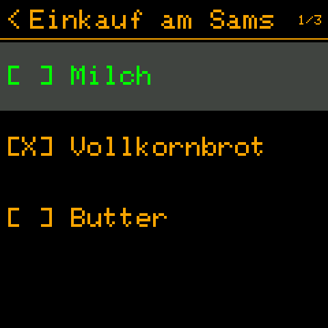

Aufgaben schreibt man auf dem Cardputer (er hat die Tastatur); auf der Uhr liest du sie und hakst sie ab.

## 📋 Textnotizen

Ein Platz für Dinge, die sofort aus dem Kopf müssen: ein Titel (die erste Zeile) und der Text, sofort auf der SD-Karte
gespeichert als einfache `.txt`-Dateien, lesbar auf jedem Computer. **CTRL+S** speichert, **ESC** verwirft die
Änderungen.

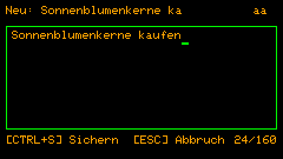 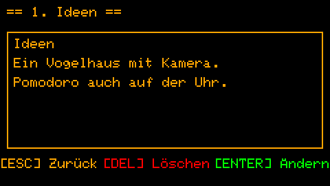

Löschen verlangt dreimal DEL - ein ausgerutschter Finger kann keine Notiz verlieren.

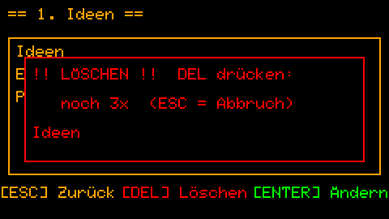

## 🧠 Gedankenablage

Für den Gedanken, der immer wieder kreist. TAB, dann M auf der Uhr: schreib ihn auf (bis zu 200 Zeichen - genug, um
ihn festzuhalten, zu wenig, um sich darin zu verlieren), ENTER, und du bist zurück, wo du warst. Die Gedanken haben
ihre eigene Liste (*Notizen → Gedankenablage*); bearbeite einen dort, und er wird zu einer richtigen Notiz.

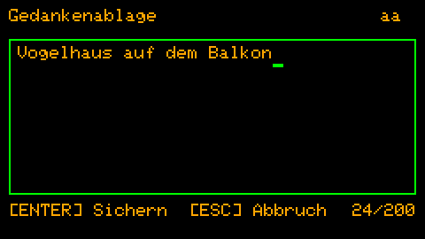

## 🎙️ Sprachnotizen

Wenn Tippen zu langsam ist: **G0** auf der Uhr oder in einem Menü startet sofort die Aufnahme, G0 noch einmal
speichert sie. Die Aufnahmen sind `.wav`-Dateien auf der SD-Karte; abspielen in *Notizen → Sprachnotizen* (Pause,
10 s zurück / vor, Lautstärke).

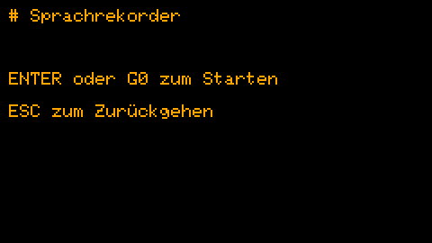 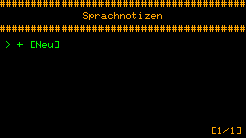

## 🔄 Routinen

Wiederkehrende Erinnerungen: ein Text, eine Uhrzeit, die Wochentage. Wenn es so weit ist, sagt es der Bildschirm -
**OPT**: erledigt (zählt in der Statistik), **DEL**: überspringen. 30 Sekunden keine Antwort: sie kommt nach einer
Pause wieder (`ROUTINE_SNOOZE_MIN`). Eine zu verpassen ändert nichts - kein Rot, keine verlorene Serie; das nächste
Mal kommt einfach.

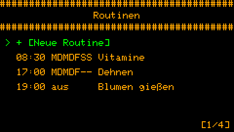 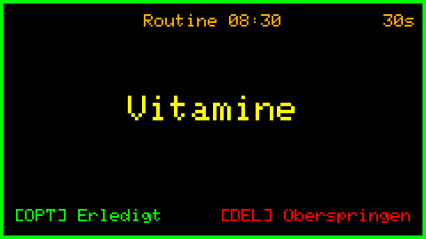

Mit synchronisierten Geräten hat eine Routine ein Feld *Geräte*: sie erscheint nur auf denen, die du anhakst (die
Vitamine auf der Uhr, die Blumen am Cardputer). Auf der Uhr schaltet man Routinen mit einem Tippen ein und aus;
geschrieben werden sie auf dem Cardputer.

## 🦅 Kuckucksuhr

Ein leises Signal zu jeder vollen Stunde - und, wenn du willst, ein sanfteres Ticken jede Viertelstunde. Kein Wecker:
ein Tippen auf die Schulter, *die Zeit vergeht*. Er läuft auch bei ausgeschaltetem Bildschirm. Ton, Summer, LED oder
Vibration, wie du es einstellst; der Ruhemodus lässt ihn nachts schweigen.

## 🍅 Pomodoro und Training

Einen Block arbeiten, ausruhen, wiederholen: Pomodoro zeigt den Block (*Arbeit*, *Pause*, *Lange Pause*), die
Restzeit und die Reihe der kommenden Blöcke. Es läuft im Hintergrund - verlass den Bildschirm, und es zählt weiter;
die Fokuszeit geht in die Statistik. *Training* ist derselbe Timer mit Blöcken, die du selbst zusammenstellst
(vorbereiten, leicht, normal, hart, Ruhe).

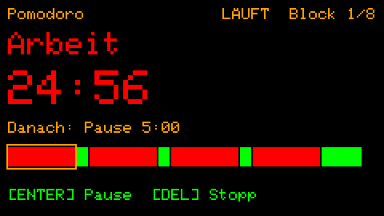 

## 🥁 Metronom und 🫁 Atmung

Das Metronom schlägt von jeder 1/8 s bis zu alle 2 Minuten - etwas Gleichmäßiges zum Folgen, im Hintergrund. Die
Atmung führt dich durch *Box 4-4-4-4*, *Entspannung 4-7-8* oder *Ruhe 5-5*: ein Kreis wächst beim Einatmen und
schrumpft beim Ausatmen (die LED folgt ihm, wenn du eine hast).

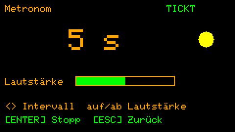 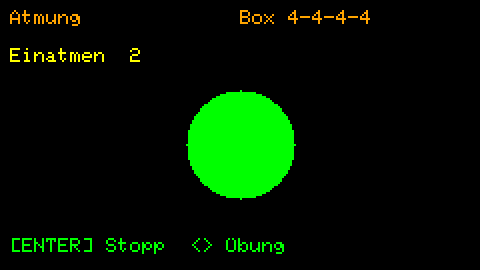

## 📊 Statistik

Die heutige Fokuszeit im Verhältnis zu deinem Ziel und die letzten 7 Tage. Keine Ziele zum Verfehlen, keine
Vergleiche - ein ruhiges Bild deiner Tage. Mit synchronisierten Geräten: LEFT / RIGHT zeigt dieses Gerät, jedes
synchronisierte oder alle zusammen.

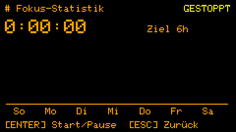 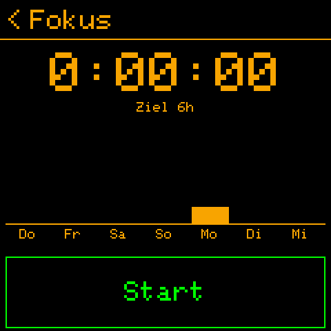

## 🔗 Bluetooth-Synchronisation

Der Cardputer und die Uhr halten sich gegenseitig auf dem Laufenden: Routinen, Aufgaben, Notizen und Einstellungen
gehen zur Uhr; Haken, das Routinen-Protokoll und die Statistik kommen zurück. **Aa** auf der Uhr des Cardputers
synchronisiert sofort; oder lass sie es selbst tun, von alle 15 Minuten bis alle 4 Stunden. Alles darüber:
[Bluetooth-Synchronisation](bluetooth.md).

 

## 🔕 Ruhemodus

Stunden und Tage, an denen Ton, Summer oder LED schweigen - jedes für sich (*Einstellungen → Ruhemodus*). Eine Nacht
zählt zu dem Tag, an dem sie beginnt.

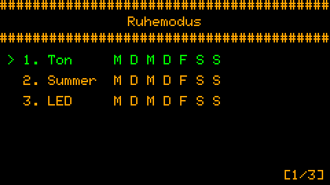 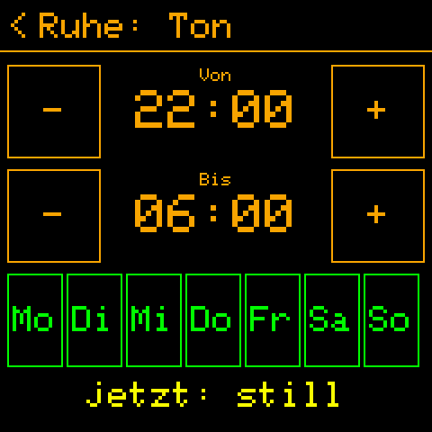

## 🎨 Anpassen und Sprachen

Farben, der Text unter der Uhr, die Pomodoro- und Fokuszeiten, die Signale, der Schlaf - alles in *Einstellungen →
Anpassen*, jedes mit einer Hilfezeile, und alles in `config.txt` auf dem Gerät gespeichert (eine einfache Textdatei,
die du auch bearbeiten kannst).

Die Bildschirme sprechen **Englisch, Polnisch, Französisch oder Deutsch** (*Anpassen → Anzeige → Sprache*); jede
Sprache außer Englisch schaltet die Schrift mit den Umlauten und Akzenten ein. Einen Text, den du anders sagen
würdest, änderst du auf dem Gerät, ohne neue Firmware:
[Squirrel!/translations/README.md](../../../Squirrel!/translations/README.md).

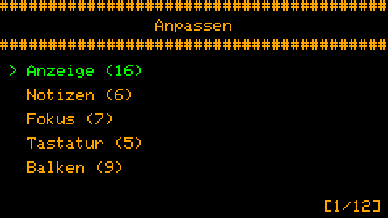 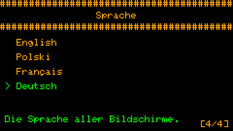

## 🔋 Energie

Der Bildschirm wird nach einer Weile ohne Taste dunkler; mit dem *Schlafmodus* schläft das Gerät, solange er gedimmt
ist (die Uhr schläft tief und wacht für ihre Routinen, den Kuckuck und ihre Sync-Zeiten auf). Die Funkmodule sind nur
an, solange sie arbeiten: WLAN für die Uhrzeit beim Start, Bluetooth für eine Synchronisation.
