# Features

*[Polski](../pl/features.md) · [Français](../fr/features.md) · [Deutsch](../de/features.md)*

What Squirrel! does, screen by screen. Version 2.0. The keys and gestures for all of it: [shortcuts.md](shortcuts.md).
Pictures: the Cardputer on the left, the watch on the right (where it has the screen).

---

## 🕐 The clock

The home screen is a clock: big digits, the date, and a line of your own at the bottom (*no need to go nuts* on the
Cardputer, *Squirrel! is watching* on the watch - change it in Personalize, or leave it). The bars at the edges
are the battery (left) and today's focus time against your goal (right). The watch also shows the weekday and, in
words, the focus time and the battery.

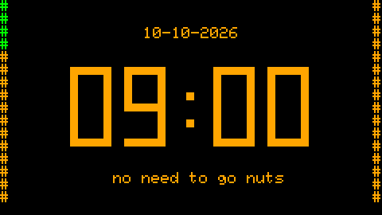 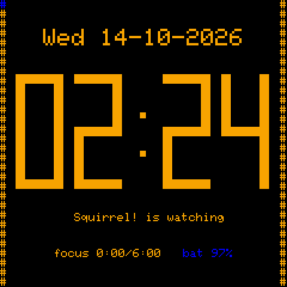

From the clock: any key opens the menu, **OPT** starts or pauses the focus timer, **Aa** syncs your devices, **TAB**
opens a small menu of the things you reach for most:

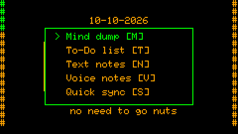

The time comes from a hardware clock where there is one (the watch's PCF8563, an optional DS1302 on the Cardputer),
from Wi-Fi at start-up, or from another Squirrel! device over Bluetooth (*Settings → Time and date → Time from a
device*).

## ✅ To-Dos and checklists

A list of things to do that does not judge you. A To-Do is a title and, if you want, more text. **OPT** marks it done
(on the watch: hold it). Done To-Dos stay for a week (`TODO_KEEP_DAYS`), then they go by themselves.

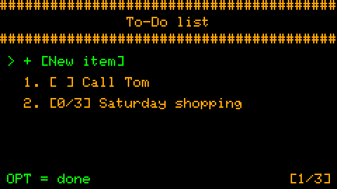 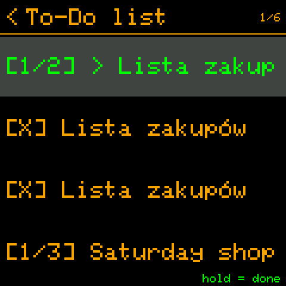

**Checklists.** Lines that start with `>` are items to tick - a shopping list, the steps of a task:

```
Saturday shopping
> milk
> bread
> nuts
remember the bag
```

Such a To-Do opens as a checklist; the list shows the progress (`[1/3]`); when every item is ticked, the whole To-Do
is done. The text of the file never changes - the ticks are kept apart.

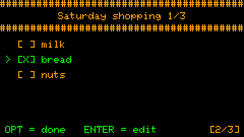 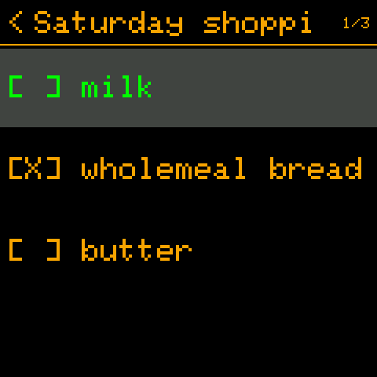

The To-Dos are written on the Cardputer (it has the keyboard); on the watch you read them and tick them.

## 📋 Text notes

A place for things that must leave your head now: a title (the first line) and the text, saved at once to the SD
card as plain `.txt` files you can read on any computer. **CTRL+S** saves, **ESC** throws the changes away.

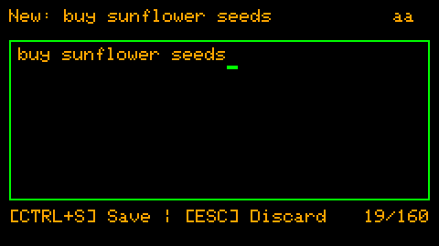 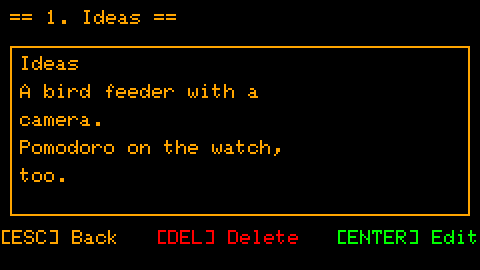

Deleting asks you to press DEL three times - a slip of the finger cannot lose a note.

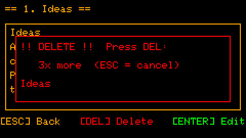

## 🧠 Mind dump

For the thought that keeps circling. TAB, then M on the clock: write it (up to 200 characters - enough to catch the
thought, too few to spiral into it), ENTER, and you are back where you were. Mind dump thoughts have their own list
(*Notes → Mind dump*); edit one there and it becomes a proper note.

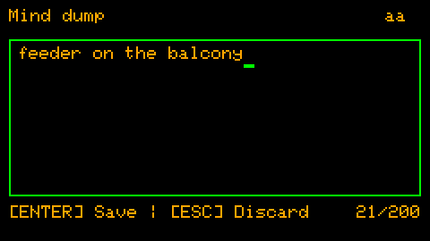

## 🎙️ Voice notes

When typing is too slow: **G0** on the clock or in a menu starts recording at once, G0 again saves. The recordings
are `.wav` files on the SD card; play them back from *Notes → Voice notes* (pause, 10 s back / forward, volume).

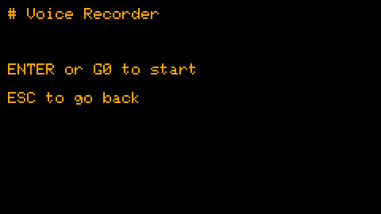 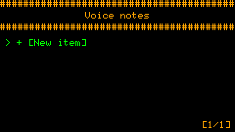

## 🔄 Routines

Recurring reminders: a text, a time of day, the days of the week. When one is due, the screen says so - **OPT**: done
(it counts in the statistics), **DEL**: skip. No answer for 30 seconds: it comes back after a snooze
(`ROUTINE_SNOOZE_MIN`). Missing one changes nothing - no red, no streak lost; the next time simply comes.

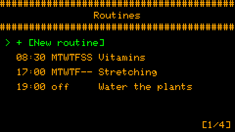 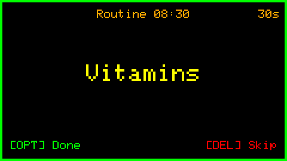

With synced devices, a routine has a *Devices* field: it comes up only on the devices you tick (the pills on the
watch, the plants on the Cardputer). On the watch, routines are switched on and off with a tap; they are written on
the Cardputer.

## 🦅 Cuckoo clock

A quiet signal on every full hour - and, if you want, a softer tick every quarter of an hour. Not an alarm: a tap on
the shoulder, *time is passing*. It keeps going with the screen off. Sound, buzzer, LED or vibration, as you set them;
silent mode keeps it quiet at night.

## 🍅 Pomodoro and training

Work for a block, rest, repeat: Pomodoro shows the block (*Work*, *Break*, *Long break*), the time left and the row of
blocks to come. It runs in the background - leave the screen and it keeps counting; the focus time goes into the
statistics. *Training* is the same timer with blocks you put together yourself (prepare, light, normal, hard, rest).

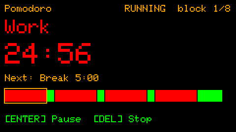 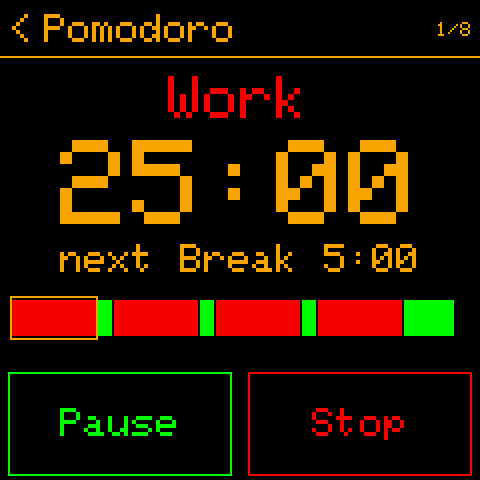

## 🥁 Metronome and 🫁 breathing

The metronome beats every 1/8 s up to every 2 minutes - something steady to follow, in the background. Breathing
guides you through *Box 4-4-4-4*, *Relax 4-7-8* or *Calm 5-5*: a circle grows as you breathe in and shrinks as you
breathe out (the LED follows it, if you have one).

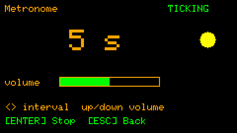 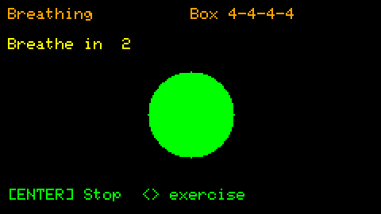

## 📊 Statistics

Today's focus time against your goal, and the last 7 days. No targets to fail, no comparisons - a quiet picture of
your days. With synced devices: LEFT / RIGHT shows this device, each synced device, or all of them together.

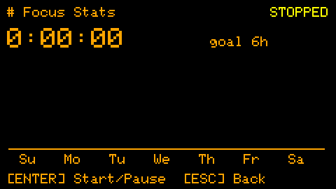 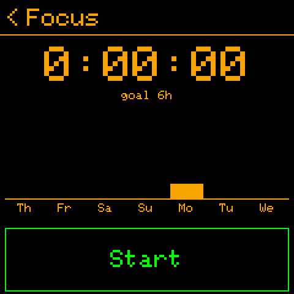

## 🔗 Bluetooth sync

The Cardputer and the watch keep each other up to date: routines, To-Dos, notes and settings go to the watch; ticks,
the routine log and statistics come back. **Aa** on the Cardputer's clock syncs at once; or let them sync by themselves
every 15 minutes to 4 hours. All about it: [bluetooth.md](bluetooth.md).

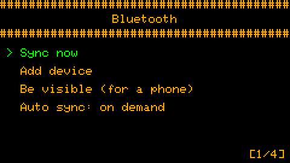 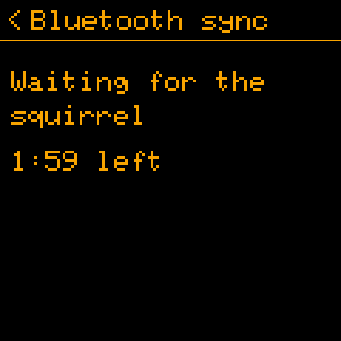

## 🔕 Silent mode

Hours and days when the sound, the buzzer or the LED keep quiet - each on its own (*Settings → Silent mode*). A night
counts for the day it starts.

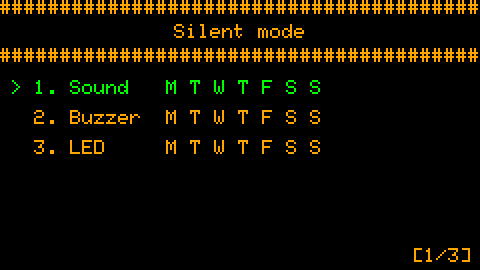 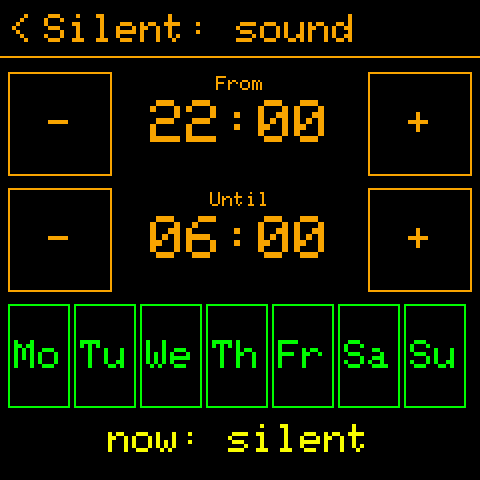

## 🎨 Personalize and languages

Colours, the text under the clock, the Pomodoro and focus times, the signals, sleep - all in *Settings → Personalize*,
each with a line of help, and all kept in `config.txt` on the device (a plain text file you may edit too).

The screens speak **English, Polish, French or German** (*Personalize → Display → Language*); any language but
English turns on the font with its accented letters. A text you would put differently can be changed on the device,
without new firmware: [Squirrel!/translations/README.md](../../../Squirrel!/translations/README.md).

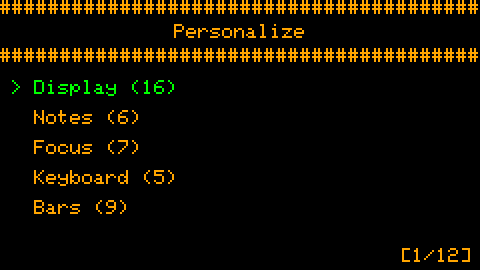 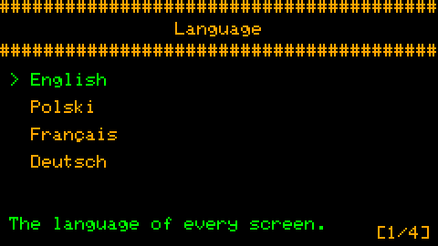

## 🔋 Energy

The screen dims after a while without a key; with *Sleep mode* the device sleeps while dimmed (the watch sleeps deeply
and wakes for its routines, the cuckoo and its sync times). The radios are on only while they work: Wi-Fi for the time
at start-up, Bluetooth for a sync.
