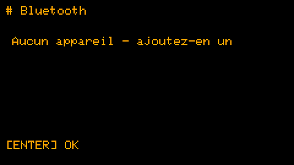

# Synchronisation Bluetooth

*[English](../en/bluetooth.md) · [Polski](../pl/bluetooth.md) · Français · [Deutsch](../de/bluetooth.md)*

Tes appareils Squirrel! se tiennent à jour mutuellement par Bluetooth. Version 2.0. Comment c'est construit (pour les
développeurs) : [implementation/fr/bluetooth.md](../../implementation/fr/bluetooth.md).

## Qu'est-ce qui va où

Un appareil est le **chef** - le Cardputer : il a le clavier, c'est donc là qu'on écrit le contenu. Les autres sont
des **nœuds** - aujourd'hui la montre.

| Quoi | Sens |
|---|---|
| le contenu des routines, tâches et notes | chef → nœud (le chef est le seul auteur) |
| les coches : tâches, éléments de listes, une routine activée / désactivée | dans les deux sens - le changement le plus récent gagne |
| le journal des routines (fait / passé / pas de réponse), les statistiques | nœud → chef, gardés à part pour chaque appareil |
| les réglages : coucou, Pomodoro, plan d'entraînement, heures de silence, report des routines, synchro auto | chef → nœud |
| l'heure | de la meilleure horloge vers la moins bonne (heure Wi-Fi > horloge matérielle > réglée à la main) |

Ce que la montre avait avant de rejoindre l'ensemble (des tâches copiées par USB, par exemple) reste à elle : le chef
ne l'écrase ni ne le supprime.

## La première fois : l'appairage

1. **Montre :** *Réglages → Bluetooth* (ou glisser vers le bas sur l'horloge) - elle attend le chef pendant 2 minutes.
2. **Cardputer :** *Réglages → Bluetooth → Ajouter un appareil* - il cherche des appareils ; ENTER sur la montre.
3. La montre affiche **6 chiffres** ; tape-les sur le Cardputer et appuie sur ENTER.

Le code n'est demandé qu'une fois. Un appareil non appairé ne reçoit rien et ne change rien.

 

## Au quotidien

- **Synchro rapide :** **Aa** sur l'horloge du Cardputer (ou TAB, puis S) synchronise chaque appareil et revient à
  l'horloge ; sur la montre, **glisser vers le bas** sur l'horloge - elle attend le Cardputer et revient d'elle-même.
- **Synchroniser** dans *Réglages → Bluetooth* fait la même chose depuis le menu ; ENTER sur un appareil ne synchronise
  que celui-là, et la liste montre quand chacun a été synchronisé et ce qui s'est passé.
- **Tout seul :** *Synchro auto* dans *Réglages → Bluetooth* (ENTER change : sur demande, toutes les 15, 30, 60, 120 ou
  240 minutes). Les synchronisations suivent l'horloge - toutes les 60 minutes veut dire aux heures pile - pour que les
  appareils se retrouvent sans se parler avant : la montre se réveille pour elles même d'un sommeil profond et écoute
  90 secondes ; le Cardputer synchronise 20 secondes après l'heure. Chaque synchronisation coûte à la montre environ
  1 mAh (sa batterie en a environ 380).

## Les statistiques de chaque appareil

Le Cardputer garde les statistiques que chaque appareil a rapportées : dans *Concentration → Statistiques*, LEFT /
RIGHT montre cet appareil, chaque appareil synchronisé, ou tous ensemble.

## Des routines sur certains appareils

Avec des appareils synchronisés, une routine a un champ *Appareils* : elle n'apparaît que sur ceux qui sont cochés.
Tous cochés veut dire chaque appareil, y compris ceux ajoutés plus tard.

## L'heure d'un appareil

*Réglages → Heure et date → Heure d'un appareil* : le Cardputer prend l'heure du premier appareil qui a une horloge
matérielle valide (la montre en a une).

## Un téléphone ou un ordinateur

[`Squirrel!/tools/web/squirrel_ble.html`](../../../Squirrel!/tools/web/squirrel_ble.html) est une page pour Chrome ou
Edge qui parle aux appareils par Web Bluetooth : reliée au Cardputer (*Réglages → Bluetooth → Être visible*), elle
modifie tâches, listes à cocher, routines, notes et réglages ; reliée à la montre, elle coche et active les routines ;
elle peut régler l'heure depuis le téléphone. Elle s'appaire avec le même code à 6 chiffres. Comment l'ouvrir :
[tools/web/README.md](../../../Squirrel!/tools/web/README.md).

Sur un ordinateur, la page s'ouvre directement depuis le dossier, sans serveur (sous Linux, Chrome a besoin d'un
drapeau activé, voir ce README) ; un téléphone en a besoin à une adresse `https://`. **Une montre retient un seul
appairage :** appairer la page avec la montre fait demander un nouveau code au Cardputer à sa prochaine
synchronisation, et appairer à nouveau le Cardputer le fait demander à la page. Appairer la page avec le Cardputer ne
change rien pour la montre.

## Oublier un appareil

Sur le Cardputer : *Réglages → Bluetooth*, l'appareil, **deux fois DEL**. Sa clé part aussi ; le rajouter demande un
nouveau code.

## ⚠️ Ce que l'appairage protège, et ce qu'il ne protège pas

Sans le code, personne ne peut synchroniser tes appareils ni les modifier. Mais les enregistrements eux-mêmes passent
dans les airs **en clair** : quelqu'un à proximité avec du matériel d'écoute Bluetooth pourrait les **lire** pendant
une synchronisation, et retrouver la clé à partir d'un appairage intercepté (le code n'a que 6 chiffres). Appaire donc
loin des inconnus, et garde mots de passe et données sensibles hors des tâches et notes synchronisées. Le chiffrement
de la liaison elle-même est prêt dans le code et sera activé quand il aura été assez testé
([backlog](../../implementation/fr/backlog.md)).

## Quand quelque chose ne va pas

| Ce que tu vois | Que faire |
|---|---|
| *Aucun appareil - ajoutez-en un* | Appaire d'abord la montre (ci-dessus). |
| *échec : pas de réponse* | Parfois une synchronisation n'obtient pas de réponse juste après la connexion ; le Cardputer réessaie dans la même passe. Si ça échoue encore, refais *Synchroniser*. |
| *Personne n'est venu* sur la montre | Le Cardputer ne s'est pas connecté dans les 2 minutes : lance la synchronisation sur lui pendant que la montre attend. |
| Un code est redemandé | Un des appareils a oublié l'appairage (réinitialisation, nouvelles données), ou la page web a été appairée avec la montre entre-temps : tape le nouveau code. |
| Le Cardputer redémarre seul au bout d'une minute | Très rarement il se fige ; un chien de garde le redémarre, tes données restent ([backlog](../../implementation/fr/backlog.md), B). |
