# Fonctions

*[English](../en/features.md) · [Polski](../pl/features.md) · Français · [Deutsch](../de/features.md)*

Ce que fait Squirrel!, écran par écran. Version 2.0. Les touches et gestes pour tout cela : [raccourcis](shortcuts.md).
Images : le Cardputer à gauche, la montre à droite (là où elle a cet écran).

---

## 🕐 L'horloge

L'écran d'accueil est une horloge : de grands chiffres, la date et une ligne à toi en bas (*no need to go nuts* sur
le Cardputer, *Squirrel! is watching* sur la montre - à changer dans Personnaliser, ou à laisser). Les barres de `#`
autour montrent le temps qui passe d'un coup d'œil :

- **à gauche** - la batterie ; **à droite** - le temps de concentration du jour par rapport à ton objectif, qui monte
  du bas (*Barre concentr. de : du haut* la remplit à l'ancienne, depuis le haut) ;
- **en haut** - l'heure qui passe, depuis la gauche ; quand le [sablier](#-sablier) tourne, son temps à la place (le
  dernier `#` coloré clignote) ;
- **en bas** - le quart d'heure, depuis la droite ; il recommence à :00, :15, :30 et :45.

Chacune peut être une barre pleine ou disparaître (*Personnaliser → Barres*). La montre affiche aussi le jour de la
semaine et, en mots, le temps de concentration et la batterie - chacun dans la couleur de sa barre.

De 10:00 à 19:59, l'heure commence par un « 1 », dessiné par son seul côté droit : l'horloge se décale alors de 10
pixels vers la gauche (16 sur la montre) pour paraître centrée (*Personnaliser → Écran → Horloge 1x:xx X* ; 0 désactive).

 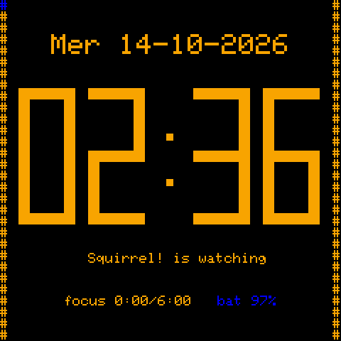

Depuis l'horloge : toute touche ouvre le menu, **OPT** lance ou met en pause le compteur de concentration, **Aa**
synchronise tes appareils, **TAB** ouvre un petit menu de ce dont tu te sers le plus :

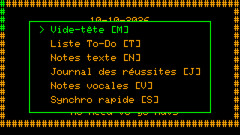

Sur la montre : un **double toucher** lance le compteur de concentration, un **triple toucher** le met en pause, un
simple toucher ouvre le menu - sur un écran allumé (un toucher sur un écran sombre ne fait que le réveiller).

L'heure vient d'une horloge matérielle quand il y en a une (le PCF8563 de la montre ; sur le Cardputer, un module
d'horloge optionnel - un DS3231 sur le port Grove, ou un DS1302 sur le connecteur EXT de l'ADV - une fois que tu as dit
lequel dans *Réglages → Heure et date → Réglages de l'heure → Module d'horloge* ; d'ici là son code n'est même pas
chargé), du Wi-Fi au démarrage, ou d'un autre appareil Squirrel! par Bluetooth (*Réglages → Heure et date → Heure d'un
appareil*).

## ✅ Tâches et listes à cocher

Une liste de choses à faire qui ne te juge pas. Une tâche, c'est un titre et, si tu veux, plus de texte. **OPT** la
marque comme faite (sur la montre : appui long). Les tâches faites restent une semaine (`TODO_KEEP_DAYS`), puis
partent d'elles-mêmes.

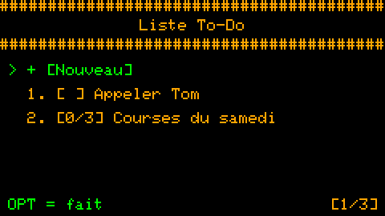 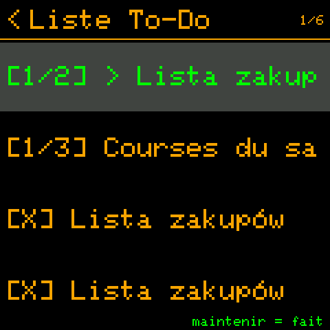

**Listes à cocher.** Les lignes qui commencent par `>` sont des éléments à cocher - une liste de courses, les étapes
d'une tâche :

```
Courses du samedi
> lait
> pain
> noix
ne pas oublier le sac
```

Une telle tâche s'ouvre comme une liste à cocher ; la liste montre l'avancement (`[1/3]`) ; quand tout est coché, la
tâche entière est faite. Le texte du fichier ne change jamais - les coches sont gardées à part.

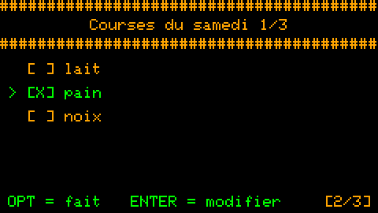 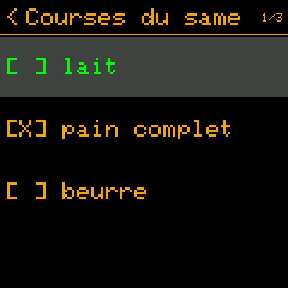

Les tâches s'écrivent sur le Cardputer (il a le clavier) ; sur la montre, tu les lis et tu les coches.

## 📋 Notes texte

Un endroit pour ce qui doit sortir de ta tête tout de suite : un titre (la première ligne) et le texte, enregistrés
aussitôt sur la carte SD en simples fichiers `.txt` lisibles sur n'importe quel ordinateur. **CTRL+S** enregistre,
**ESC** abandonne les modifications.

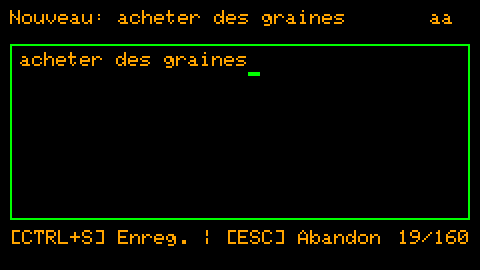 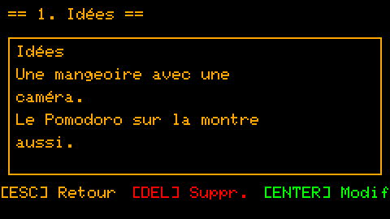

Supprimer demande d'appuyer trois fois sur DEL - un doigt qui glisse ne peut pas effacer une note.

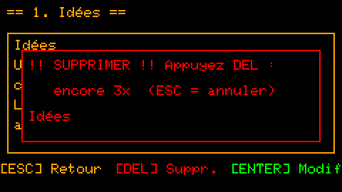

## 🏆 Journal des réussites

Une liste par jour de ce qui a marché - les petites choses comptent. *Notes → Journal des réussites → + [Aujourd'hui]*
ouvre la liste du jour avec une nouvelle ligne prête : chaque ligne qui commence par `-` ou `>` est une chose faite
(comme dans la liste à cocher d'une tâche) ; les autres lignes sont du texte. Le nombre de choses faites va dans les
statistiques, à part du temps de concentration.

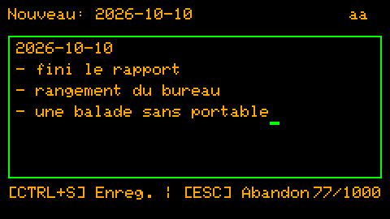

## 🧠 Vide-tête

Pour la pensée qui tourne en rond. TAB, puis M sur l'horloge : écris-la (jusqu'à 200 caractères - assez pour l'attraper,
trop peu pour s'y perdre), ENTER, et te voilà de retour où tu étais. Les pensées du vide-tête ont leur propre liste
(*Notes → Vide-tête*) ; modifies-en une et elle devient une vraie note.

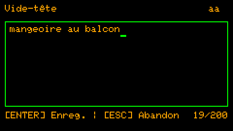

## 🎙️ Notes vocales

Quand taper est trop lent : **G0** sur l'horloge ou dans un menu lance l'enregistrement tout de suite, G0 à nouveau
l'enregistre. Ce sont des fichiers `.wav` sur la carte SD ; tu les réécoutes dans *Notes → Notes vocales* (pause,
10 s en arrière / en avant, volume).

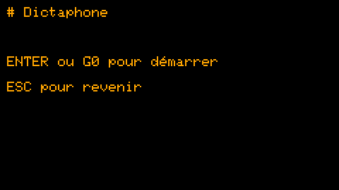 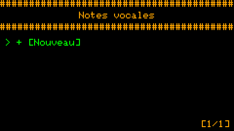

## 🔄 Routines

Des rappels récurrents : un texte, une heure, les jours de la semaine. Quand c'est l'heure, l'écran le dit - **OPT** :
fait (compte dans les statistiques), **DEL** : passer. Pas de réponse pendant 30 secondes : il revient après un report
(`ROUTINE_SNOOZE_MIN`). En rater une ne change rien - pas de rouge, pas de série perdue ; la fois suivante arrive
simplement.

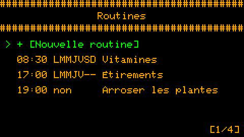 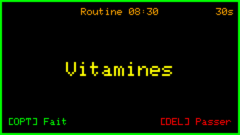

Avec des appareils synchronisés, une routine a un champ *Appareils* : elle n'apparaît que sur ceux que tu coches (les
vitamines sur la montre, les plantes sur le Cardputer). Sur la montre, on active et désactive les routines d'un
toucher ; on les écrit sur le Cardputer.

## 🦅 Horloge à coucou

Un signal discret à chaque heure pile - et, si tu veux, un tic plus doux à chaque quart d'heure. Pas une alarme : une
tape sur l'épaule, *le temps passe*. Il continue écran éteint. Son, buzzer, LED ou vibration, comme tu les règles ; le
mode silencieux le fait taire la nuit.

## 🍅 Pomodoro et entraînement

Travailler un bloc, se reposer, recommencer : le Pomodoro montre le bloc (*Travail*, *Pause*, *Longue pause*), le
temps restant et la rangée des blocs à venir. Il tourne en arrière-plan - quitte l'écran, il continue de compter ; le
temps de concentration va dans les statistiques. *Entraînement*, c'est le même minuteur avec des blocs que tu composes
toi-même (préparation, léger, normal, intense, repos).

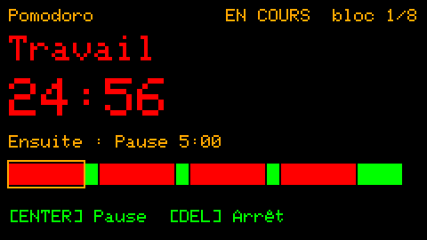 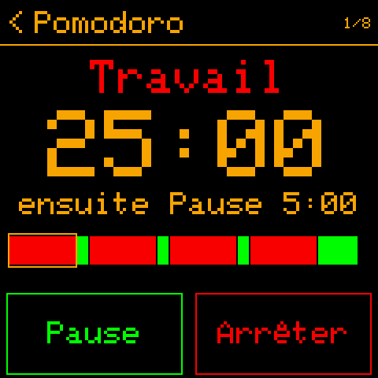

## ⏳ Sablier

Un simple compte à rebours : règle les minutes, lance-le et occupe-toi du reste. La barre du haut de l'horloge se
remplit à mesure que le temps file ; à la fin il sonne - son, LED et buzzer ou vibration, toutes les quelques secondes
jusqu'à ce que tu répondes - même pendant les heures de silence, puisque tu l'as réglé toi-même. Il tourne en
arrière-plan comme le Pomodoro et garde les minutes pour la prochaine fois.

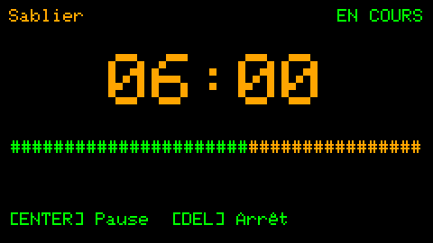 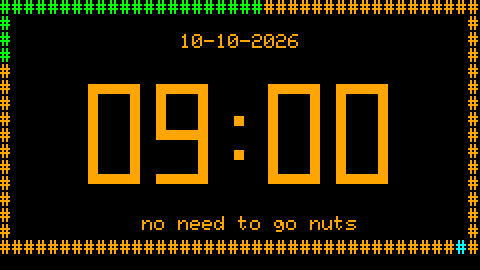

## 🥁 Métronome et 🫁 respiration

Le métronome bat de toutes les 1/8 s à toutes les 2 minutes - quelque chose de régulier à suivre, en arrière-plan - avec un bip court, ou un clic sec comme
une horloge (*Personnaliser → Audio → Son métronome*). La
respiration te guide à travers *Carré 4-4-4-4*, *Détente 4-7-8* ou *Calme 5-5* : un cercle grandit à l'inspiration et
rétrécit à l'expiration (la LED le suit, si tu en as une).

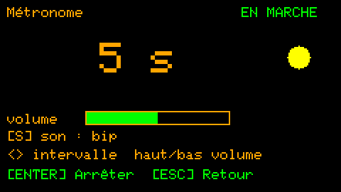 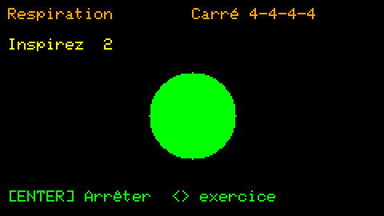

## 📊 Statistiques

Le temps de concentration du jour par rapport à ton objectif, et les 7 derniers jours. Pas d'objectif à rater, pas de
comparaisons - une image paisible de tes journées. Avec des appareils synchronisés : LEFT / RIGHT montre cet appareil,
chaque appareil synchronisé, ou tous ensemble.

Une distraction comptée comme concentration ? **-** retire les 15 dernières minutes (*Personnaliser → Concentration →
Minutes à retirer*) ; DEL deux fois remet la journée à zéro. Sous le temps du jour : ce qui a marché aujourd'hui et
cette semaine, d'après le journal des réussites.

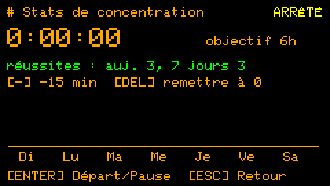 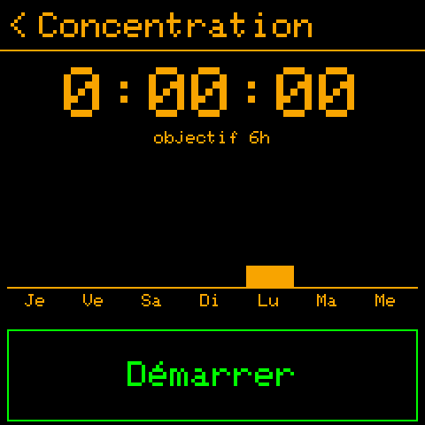

## 🔗 Synchronisation Bluetooth

Le Cardputer et la montre se tiennent à jour : routines, tâches, notes et réglages vont à la montre ; les coches, le
journal des routines et les statistiques reviennent. **Aa** sur l'horloge du Cardputer synchronise tout de suite ; ou
laisse-les se synchroniser seuls, de toutes les 15 minutes à toutes les 4 heures. Tout à ce sujet :
[synchronisation Bluetooth](bluetooth.md).

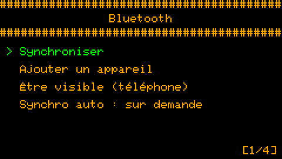 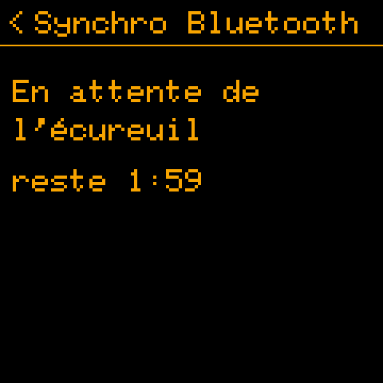

## 🔕 Mode silencieux

Les heures et les jours où le son, le buzzer ou la LED se taisent - chacun à part (*Réglages → Mode silencieux*). Une
nuit compte pour le jour où elle commence.

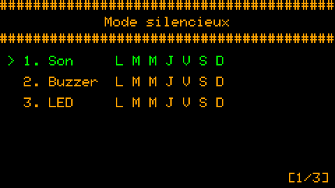 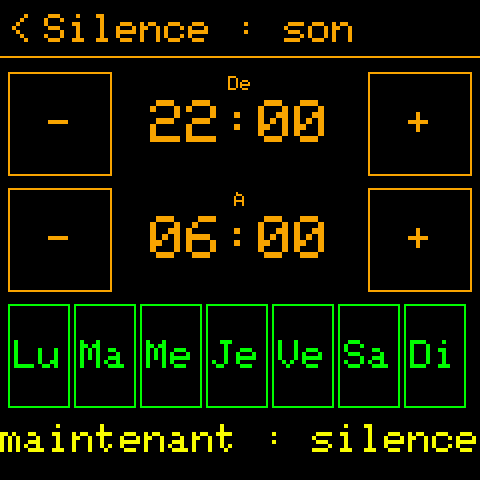

## 🎨 Personnaliser et langues

Les couleurs, le texte sous l'horloge, les durées du Pomodoro et de la concentration, les signaux, la veille - tout est
dans *Réglages → Personnaliser*, chacun avec une ligne d'aide, et tout est gardé dans `config.txt` sur l'appareil (un
simple fichier texte que tu peux aussi modifier).

Les écrans parlent **anglais, polonais, français ou allemand** (*Personnaliser → Écran → Langue*) ; toute langue autre
que l'anglais active la police avec les lettres accentuées. Un texte que tu formulerais autrement se change sur
l'appareil, sans nouveau firmware : [Squirrel!/translations/README.md](../../../Squirrel!/translations/README.md).

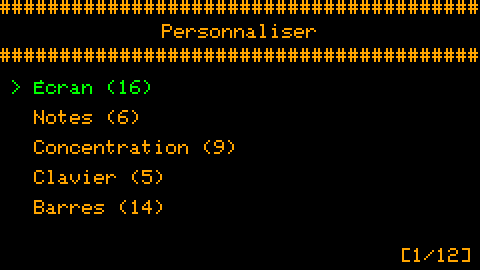 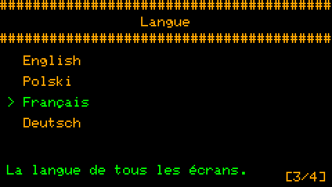

## 🔋 Énergie

L'écran baisse après un moment sans touche ; avec le *Mode veille*, l'appareil dort pendant qu'il est assombri (la
montre dort profondément et se réveille pour ses routines, le coucou et ses heures de synchronisation). Les radios ne
sont allumées que lorsqu'elles travaillent : le Wi-Fi pour l'heure au démarrage, le Bluetooth pour une synchronisation. Le Cardputer ADV n'a pas de mode veille pour l'instant : en sommeil
léger, son rétroéclairage clignotait et G0 lançait le dictaphone tout seul (à résoudre) ; l'économie écran assombri
reste. Sur le premier Cardputer, le mode veille est expérimental (*Réglages → Expérimental → Réglages*).

**Une batterie faible** est annoncée à 15 %, 10 %, 5 % et juste avant qu'elle soit vide - à l'écran, avec un son et le
buzzer ou la vibration si tu le veux (*Personnaliser → Énergie → Alertes batterie*, *Son de l'alerte* ; *Buzzer →
Batterie faible*). La LED peut clignoter avec l'alerte (*Personnaliser → LED → Batterie : clign.*).
Pendant la charge, un petit éclair apparaît près de la barre de batterie de l'horloge (*Personnaliser → Barres →
Signe de charge*).

**La charge.** La puce d'alimentation de la montre dit quand elle charge (ou qu'elle est sur l'USB, pleine). Les
Cardputer ne le savent pas : leur batterie est seulement mesurée. *Réglages → Expérimental → Réglages → Détection charge* leur fait
deviner - d'après la tension de la batterie (elle saute quand un chargeur arrive ou part, et monte lentement pendant la
charge) et un ordinateur sur l'USB. Un simple chargeur sans données ne se voit pas autrement. Expérimental : dis-nous si
elle devine bien.
