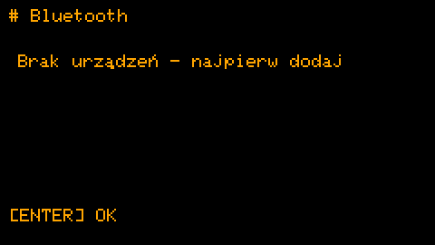

# Synchronizacja Bluetooth

*[English](../en/bluetooth.md) · Polski · [Français](../fr/bluetooth.md) · [Deutsch](../de/bluetooth.md)*

Twoje urządzenia Squirrel! trzymają się nawzajem na bieżąco przez Bluetooth. Wersja 2.0. Jak to jest zbudowane (dla
programistów): [implementation/pl/bluetooth.md](../../implementation/pl/bluetooth.md).

## Co dokąd idzie

Jedno urządzenie jest **szefem** - Cardputer: ma klawiaturę, więc tam powstaje treść. Pozostałe to **nody** - dziś
zegarek.

| Co | Kierunek |
|---|---|
| treść rutyn, zadań i notatek | szef → node (szef jest jedynym autorem) |
| odhaczenia: zadania, punkty checklist, rutyna wł. / wył. | w obie strony - wygrywa późniejsza zmiana |
| log rutyn (zrobione / pominięte / bez odpowiedzi), statystyki | node → szef, osobno dla każdego urządzenia |
| ustawienia: kukułka, Pomodoro, plan treningu, godziny ciszy, drzemka rutyn, auto-synchronizacja | szef → node |
| czas | z lepszego zegara do gorszego (czas z Wi-Fi > zegar sprzętowy > ustawiony ręcznie) |

To, co zegarek miał, zanim dołączył (na przykład zadania skopiowane przez USB), zostaje jego własne: szef ani tego nie
nadpisuje, ani nie usuwa.

## Pierwszy raz: parowanie

1. **Zegarek:** *Ustawienia → Bluetooth* (albo przesunięcie w dół na zegarze) - czeka na szefa 2 minuty.
2. **Cardputer:** *Ustawienia → Bluetooth → Dodaj urządzenie* - szuka urządzeń; ENTER na zegarku.
3. Zegarek pokazuje **6 cyfr**; wpisz je na Cardputerze i naciśnij ENTER.

Kod jest potrzebny tylko raz. Urządzenie niesparowane niczego nie dostaje i niczego nie zmienia.

 

## Na co dzień

- **Szybka synchronizacja:** **Aa** na zegarze Cardputera (albo TAB, potem S) synchronizuje każde urządzenie i wraca
  na zegar; na zegarku **przesunięcie w dół** na zegarze - czeka na Cardputera i sam wraca.
- **Synchronizuj teraz** w *Ustawienia → Bluetooth* robi to samo z menu; ENTER na urządzeniu synchronizuje tylko to
  jedno, a lista pokazuje, kiedy każde było synchronizowane i co się stało.
- **Samo z siebie:** *Auto-synchronizacja* w *Ustawienia → Bluetooth* (ENTER przełącza: na żądanie, co 15, 30, 60, 120
  albo 240 minut). Synchronizacje są według zegara - co 60 minut znaczy o pełnych godzinach - więc urządzenia spotykają
  się bez wcześniejszej rozmowy: zegarek budzi się na nie nawet z głębokiego snu i nasłuchuje 90 sekund; Cardputer
  synchronizuje 20 sekund po pełnej godzinie. Każda synchronizacja kosztuje zegarek około 1 mAh (jego bateria ma około
  380).

## Statystyki każdego urządzenia

Cardputer trzyma statystyki, które zgłosiło każde urządzenie: w *Skup się → Statystyki* LEFT / RIGHT pokazuje to
urządzenie, każde zsynchronizowane albo wszystkie razem.

## Rutyny na wybranych urządzeniach

Przy synchronizowanych urządzeniach rutyna ma pole *Urządzenia*: pojawia się tylko na zaznaczonych. Wszystkie
zaznaczone znaczy każde urządzenie, także te dodane później.

## Czas z urządzenia

*Ustawienia → Czas i data → Czas z urządzenia*: Cardputer bierze czas z pierwszego urządzenia z prawidłowym zegarem
sprzętowym (zegarek go ma).

## Telefon albo komputer

[`Squirrel!/tools/web/squirrel_ble.html`](../../../Squirrel!/tools/web/squirrel_ble.html) to strona dla Chrome albo Edge,
która rozmawia z urządzeniami przez Web Bluetooth: połączona z Cardputerem (*Ustawienia → Bluetooth → Bądź widoczny*)
edytuje zadania, checklisty, rutyny, notatki i ustawienia; połączona z zegarkiem odhacza i przełącza rutyny; potrafi
ustawić czas z telefonu. Paruje się tym samym 6-cyfrowym kodem. Jak ją otworzyć:
[tools/web/README.md](../../../Squirrel!/tools/web/README.md).

Na komputerze strona otwiera się prosto z folderu, bez serwera (na Linuksie Chrome potrzebuje włączenia jednej flagi,
zobacz ten README); telefon potrzebuje jej pod adresem `https://`. **Zegarek pamięta jedno parowanie:** sparowanie
strony z zegarkiem sprawia, że Cardputer przy następnej synchronizacji poprosi o nowy kod, a ponowne sparowanie
Cardputera - że poprosi strona. Sparowanie strony z Cardputerem niczego nie zmienia dla zegarka.

## Zapominanie urządzenia

Na Cardputerze: *Ustawienia → Bluetooth*, urządzenie, **dwa razy DEL**. Jego klucz też znika; ponowne dodanie prosi o
nowy kod.

## ⚠️ Co parowanie chroni, a czego nie

Bez kodu nikt nie zsynchronizuje ani nie zmieni Twoich urządzeń. Ale same rekordy idą w powietrzu **nieszyfrowane**:
ktoś w pobliżu ze sprzętem do podsłuchu Bluetooth mógłby je **przeczytać** w trakcie synchronizacji i odtworzyć klucz z
podsłuchanego parowania (kod ma tylko 6 cyfr). Paruj więc z dala od obcych i nie trzymaj haseł ani danych wrażliwych w
synchronizowanych zadaniach i notatkach. Szyfrowanie samego łącza jest gotowe w kodzie i zostanie włączone, gdy będzie
dość sprawdzone ([backlog](../../implementation/pl/backlog.md)).

## Gdy coś nie działa

| Co widzisz | Co zrobić |
|---|---|
| *Brak urządzeń - najpierw dodaj* | Najpierw sparuj zegarek (wyżej). |
| *błąd: brak odpowiedzi* | Czasem synchronizacja nie dostaje odpowiedzi tuż po połączeniu; Cardputer próbuje jeszcze raz w tym samym podejściu. Jeśli dalej nie wychodzi, jeszcze raz *Synchronizuj teraz*. |
| *Nikt się nie połączył* na zegarku | Cardputer nie połączył się w ciągu 2 minut: zacznij synchronizację na nim, gdy zegarek czeka. |
| Znów prosi o kod | Któreś z urządzeń zapomniało parowanie (reset, nowe dane) albo w międzyczasie sparowano z zegarkiem stronę www: wpisz nowy kod. |
| Cardputer sam się restartuje po minucie | Bardzo rzadko się zawiesza; watchdog go restartuje, dane zostają ([backlog](../../implementation/pl/backlog.md), B). |
