# Funkcje

*[English](../en/features.md) · Polski · [Français](../fr/features.md) · [Deutsch](../de/features.md)*

Co robi Squirrel!, ekran po ekranie. Wersja 2.0. Klawisze i gesty do wszystkiego: [skróty](shortcuts.md).
Zdjęcia: Cardputer po lewej, zegarek po prawej (tam, gdzie ma ten ekran).

---

## 🕐 Zegar

Ekran startowy to zegar: duże cyfry, data i Twoja własna linijka na dole (*no need to go nuts* na Cardputerze,
*Squirrel! is watching* na zegarku - zmienisz ją w Personalizacji albo zostawisz). Belki z `#` dookoła pokazują
upływ czasu jednym rzutem oka:

- **lewa** - bateria; **prawa** - dzisiejszy czas skupienia względem Twojego celu, rośnie od dołu (*Belka skupienia
  od: od góry* wypełnia ją klasycznie, od góry);
- **górna** - upływ godziny, wypełnia się od lewej; gdy działa [klepsydra](#-klepsydra) - jej czas (ostatni kolorowy
  `#` miga);
- **dolna** - upływ kwadransa, wypełnia się od prawej; zaczyna od nowa o :00, :15, :30 i :45.

Każda może być pełną, stałą belką albo zniknąć (*Personalizacja → Belki*). Zegarek pokazuje też dzień tygodnia oraz,
słowami, czas skupienia i baterię - każde w kolorze swojej belki.

Godziny od 10:00 do 19:59 zaczynają się od „1”, rysowanej samą prawą stroną, więc zegar przesuwa się wtedy o 10
pikseli w lewo (na zegarku o 16), żeby wyglądał na wyśrodkowany (*Personalizacja → Ekran → Zegar 1x:xx X*; 0 wyłącza).

 

Z zegara: każdy klawisz otwiera menu, **OPT** włącza lub wstrzymuje licznik skupienia, **Aa** synchronizuje Twoje
urządzenia, **TAB** otwiera małe menu tego, po co sięgasz najczęściej:

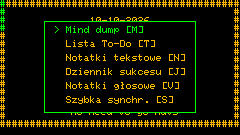

Na zegarku: **podwójne stuknięcie** włącza licznik skupienia, **potrójne** go wstrzymuje, pojedyncze otwiera menu - wszystko na zapalonym ekranie (stuknięcie w ciemny tylko go budzi).

Czas pochodzi ze sprzętowego zegara, jeśli jest (PCF8563 w zegarku; w Cardputerze opcjonalny moduł zegara - DS3231
na porcie Grove albo DS1302 na złączu EXT wersji ADV - gdy wskażesz, który, w *Ustawienia → Czas i data → Ustawienia
czasu → Moduł zegara*; do tego czasu jego kod nawet się nie ładuje), z Wi-Fi przy starcie albo z innego urządzenia
Squirrel! przez Bluetooth (*Ustawienia → Czas i data → Czas z urządzenia*).

## ✅ Zadania i checklisty

Lista rzeczy do zrobienia, która Cię nie ocenia. Zadanie to tytuł i, jeśli chcesz, więcej tekstu. **OPT** oznacza je
jako zrobione (na zegarku: przytrzymaj). Zrobione zadania zostają tydzień (`TODO_KEEP_DAYS`), potem znikają same.

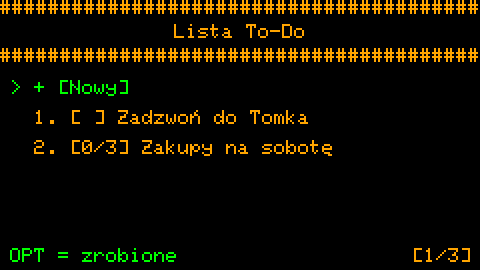 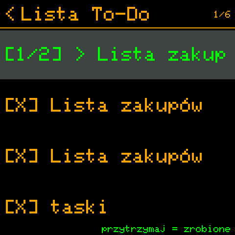

**Checklisty.** Linie zaczynające się od `>` to punkty do odhaczenia - lista zakupów, kroki zadania:

```
Zakupy na sobotę
> mleko
> chleb
> orzechy
pamiętaj o torbie
```

Takie zadanie otwiera się jako checklista; lista pokazuje postęp (`[1/3]`); gdy wszystkie punkty są odhaczone, całe
zadanie jest zrobione. Tekst pliku nigdy się nie zmienia - odhaczenia są trzymane osobno.

 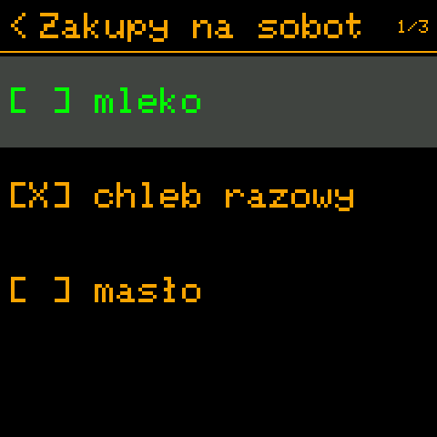

Zadania pisze się na Cardputerze (ma klawiaturę); na zegarku je czytasz i odhaczasz.

## 📋 Notatki tekstowe

Miejsce na rzeczy, które muszą natychmiast wyjść z głowy: tytuł (pierwsza linia) i tekst, od razu zapisane na kartę
SD jako zwykłe pliki `.txt`, czytelne na każdym komputerze. **CTRL+S** zapisuje, **ESC** odrzuca zmiany.

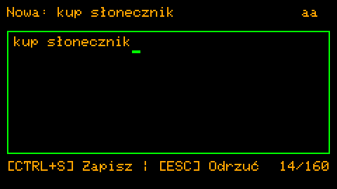 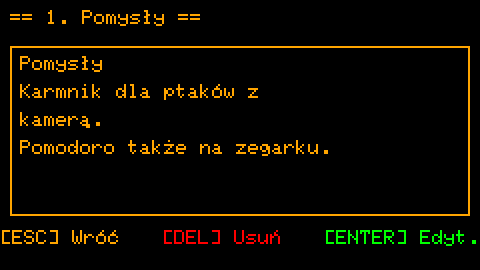

Usuwanie wymaga trzykrotnego naciśnięcia DEL - przypadkowy ruch palca nie skasuje notatki.

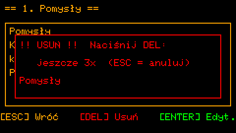

## 🏆 Dziennik sukcesu

Jedna lista na dzień tego, co się udało - małe rzeczy też się liczą. *Notatki → Dziennik sukcesu → + [Dzisiaj]* otwiera
dzisiejszą listę z gotową nową linią: każda linia zaczęta od `-` albo `>` to jedna zrobiona rzecz (jak w checkliście
zadania); pozostałe linie to zwykły tekst. Liczba zrobionych rzeczy trafia do statystyk, osobno od czasu skupienia.

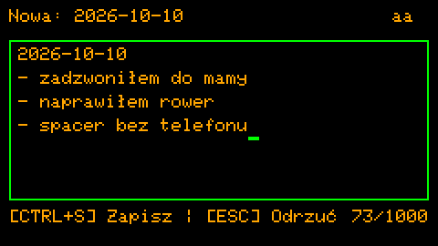

## 🧠 Mind dump

Na myśl, która ciągle krąży. TAB, potem M na zegarze: zapisz ją (do 200 znaków - dość, żeby ją złapać, za mało, żeby
się w nią wkręcić), ENTER i wracasz tam, gdzie byłeś. Myśli z Mind dumpa mają własną listę (*Notatki → Mind dump*);
popraw jedną z nich, a stanie się zwykłą notatką.

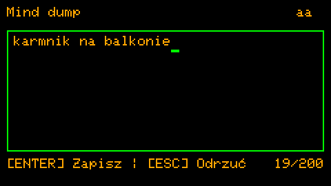

## 🎙️ Notatki głosowe

Gdy pisanie jest za wolne: **G0** na zegarze albo w menu od razu zaczyna nagrywać, G0 jeszcze raz zapisuje. Nagrania
to pliki `.wav` na karcie SD; odtwarzasz je w *Notatki → Notatki głosowe* (pauza, 10 s wstecz / do przodu,
głośność).

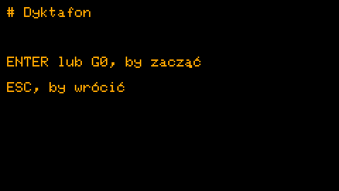 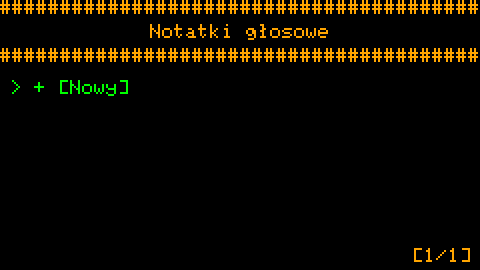

## 🔄 Rutyny

Powtarzające się przypomnienia: tekst, godzina, dni tygodnia. Gdy przychodzi pora, ekran o tym mówi - **OPT**:
zrobione (liczy się w statystykach), **DEL**: pomiń. Brak odpowiedzi przez 30 sekund: wraca po drzemce
(`ROUTINE_SNOOZE_MIN`). Pominięcie niczego nie zmienia - żadnej czerwieni, żadnego straconego streaka; po prostu
przychodzi następny raz.

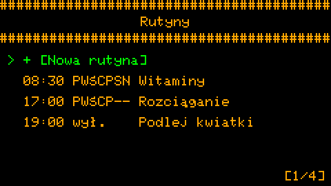 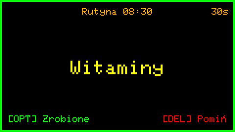

Przy synchronizowanych urządzeniach rutyna ma pole *Urządzenia*: pojawia się tylko na tych, które zaznaczysz
(witaminy na zegarku, kwiatki na Cardputerze). Na zegarku rutyny włącza się i wyłącza stuknięciem; pisze się je na
Cardputerze.

## 🦅 Zegar z kukułką

Cichy sygnał o każdej pełnej godzinie - a jeśli chcesz, delikatniejsze tyknięcie co kwadrans. Nie budzik: klepnięcie
w ramię, *czas płynie*. Działa także przy wyłączonym ekranie. Dźwięk, brzęczyk, dioda albo wibracja, jak ustawisz;
tryb cichy wycisza go w nocy.

## 🍅 Pomodoro i trening

Praca przez blok, odpoczynek, powtórka: Pomodoro pokazuje blok (*Praca*, *Przerwa*, *Długa przerwa*), pozostały czas i
rząd kolejnych bloków. Działa w tle - wyjdź z ekranu, a dalej liczy; czas skupienia trafia do statystyk. *Trening* to
ten sam timer z blokami, które układasz sam (przygotuj, lekko, normalnie, mocno, odpoczynek).

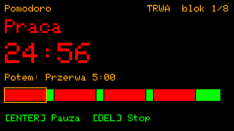 

## ⏳ Klepsydra

Zwykły minutnik: ustaw minuty, włącz i zajmij się swoim. Górna belka zegara wypełnia się, gdy czas ucieka; na końcu
dzwoni - dźwięk, dioda i brzęczyk albo wibracja, co kilka sekund, aż odpowiesz - także w godzinach ciszy, bo
ustawiłeś ją sam. Działa w tle jak Pomodoro i pamięta minuty na następny raz.

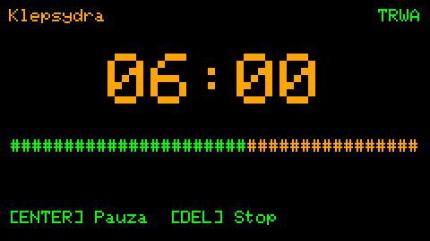 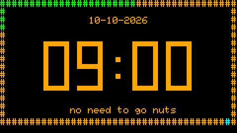

## 🥁 Metronom i 🫁 oddychanie

Metronom wybija rytm co 1/8 s, aż do raz na 2 minuty - coś stałego, za czym można iść, w tle. Bije krótkim piskiem albo suchym kliknięciem jak zegar
(*Personalizacja → Dźwięk → Dźwięk metronomu*). Oddychanie prowadzi
przez *Kwadrat 4-4-4-4*, *Relaks 4-7-8* albo *Spokój 5-5*: koło rośnie przy wdechu i maleje przy wydechu (dioda idzie
za nim, jeśli ją masz).

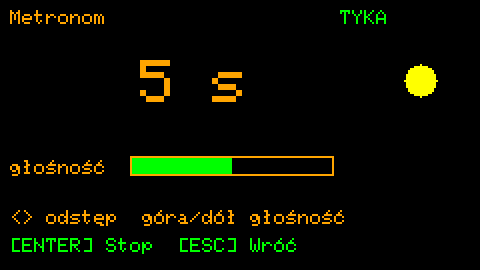 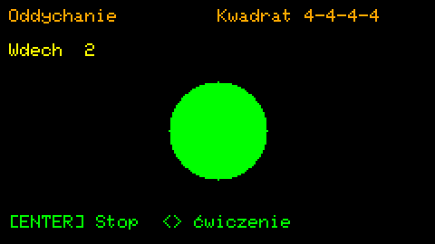

## 📊 Statystyki

Dzisiejszy czas skupienia względem celu i ostatnie 7 dni. Żadnych celów do zawalenia, żadnych porównań - spokojny
obraz Twoich dni. Przy synchronizowanych urządzeniach LEFT / RIGHT pokazuje to urządzenie, każde zsynchronizowane albo
wszystkie razem.

Rozproszenie policzone jako skupienie? **-** odejmuje ostatnie 15 minut (*Personalizacja → Skupienie → Odejmij
minuty*); DEL dwa razy zeruje dzień. Pod dzisiejszym czasem: co się udało dziś i w tym tygodniu, z dziennika sukcesu.

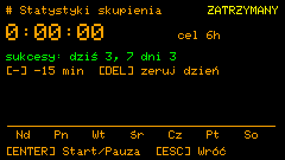 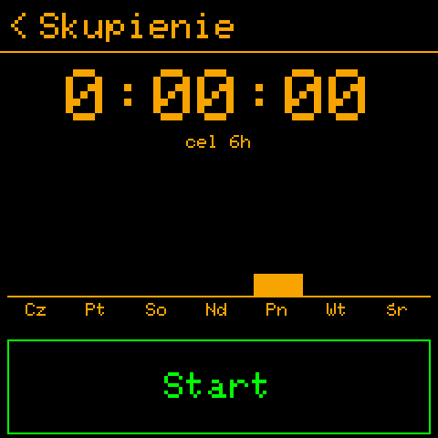

## 🔗 Synchronizacja Bluetooth

Cardputer i zegarek trzymają się na bieżąco: rutyny, zadania, notatki i ustawienia idą do zegarka; odhaczenia, log
rutyn i statystyki wracają. **Aa** na zegarze Cardputera synchronizuje od razu; albo pozwól im robić to samym, od co
15 minut do co 4 godziny. Wszystko o tym: [synchronizacja Bluetooth](bluetooth.md).

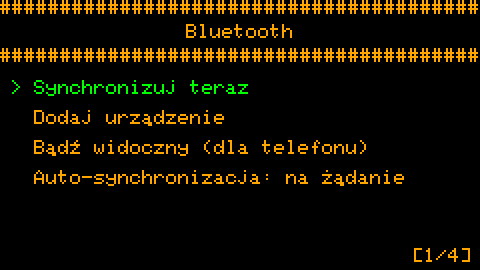 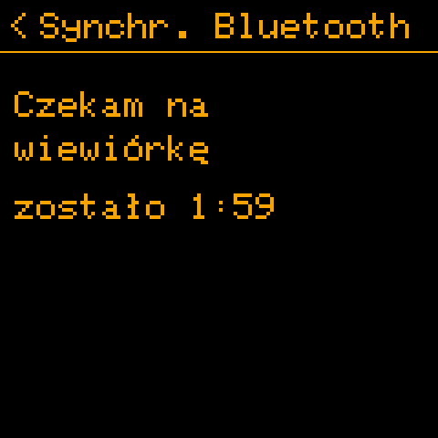

## 🔕 Tryb cichy

Godziny i dni, w których dźwięk, brzęczyk albo dioda milczą - każde osobno (*Ustawienia → Tryb cichy*). Noc liczy się
do dnia, w którym się zaczyna.

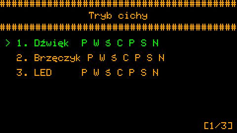 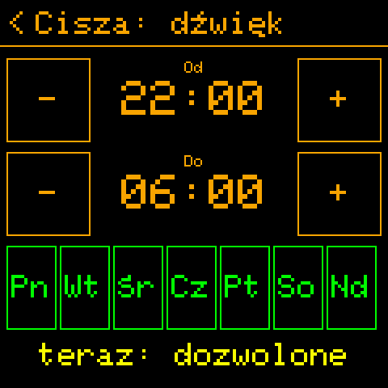

## 🎨 Personalizacja i języki

Kolory, tekst pod zegarem, czasy Pomodoro i skupienia, sygnały, usypianie - wszystko w *Ustawienia → Personalizacja*,
każde z linijką pomocy, i wszystko trzymane w `config.txt` na urządzeniu (zwykły plik tekstowy, który też możesz
edytować).

Ekrany mówią **po angielsku, polsku, francusku albo niemiecku** (*Personalizacja → Ekran → Język*); każdy język poza
angielskim włącza czcionkę z literami diakrytycznymi. Tekst, który ująłbyś inaczej, zmienisz na urządzeniu, bez nowego
firmware: [Squirrel!/translations/README.md](../../../Squirrel!/translations/README.md).

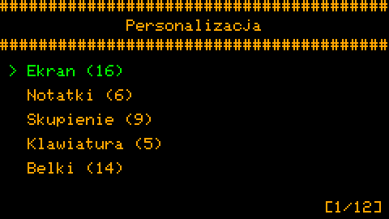 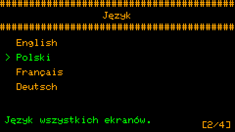

## 🔋 Energia

Ekran przygasa po chwili bez klawisza; z *Trybem uśpienia* urządzenie śpi, gdy jest przygaszone (zegarek śpi głęboko
i budzi się na swoje rutyny, kukułkę i pory synchronizacji). Radia działają tylko wtedy, gdy pracują: Wi-Fi do czasu
przy starcie, Bluetooth na synchronizację. Cardputer ADV nie ma na razie trybu uśpienia: w lekkim śnie migało
podświetlenie, a przycisk G0 sam uruchamiał dyktafon (temat do rozwiązania); zostaje oszczędzanie przy wygaszonym
ekranie. Na pierwszym Cardputerze tryb uśpienia jest eksperymentalny (*Ustawienia → Eksperymentalne → Ustawienia*).

**Słaba bateria** jest zgłaszana przy 15 %, 10 %, 5 % i tuż przed rozładowaniem - na ekranie, dźwiękiem i brzęczykiem
albo wibracją, jeśli chcesz (*Personalizacja → Zasilanie → Ostrzeż. baterii*, *Dźwięk ostrzeżenia*; *Brzęczyk → Słaba
bateria*). Dioda może mrugnąć razem z ostrzeżeniem (*Personalizacja → LED → Bateria: mrug.*).
Podczas ładowania przy belce baterii na zegarze widać małą błyskawicę (*Personalizacja → Belki → Znak
ładowania*).

**Ładowanie.** Układ zasilania zegarka mówi, kiedy ładuje (albo stoi na zasilaniu z USB, pełny). Cardputery tego nie
wiedzą: ich baterię tylko się mierzy. *Ustawienia → Eksperymentalne → Ustawienia → Wykrywanie ładow.* każe im zgadywać - z napięcia
baterii (skacze, gdy ładowarka przychodzi albo odchodzi, i powoli rośnie, gdy bateria się napełnia) i z komputera na
USB. Zwykłej ładowarki bez linii danych nie da się zobaczyć inaczej. Eksperymentalne: daj znać, jak trafnie zgaduje.
