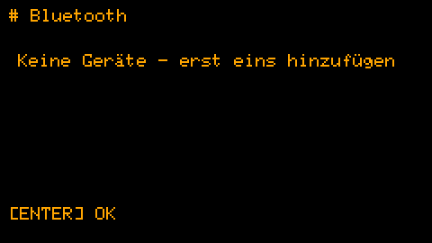
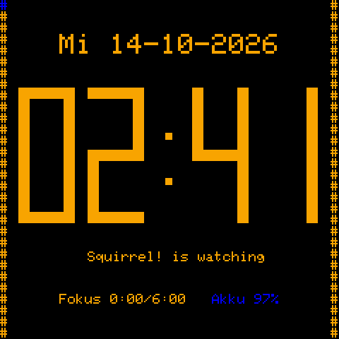
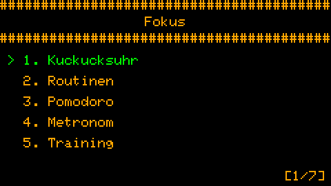
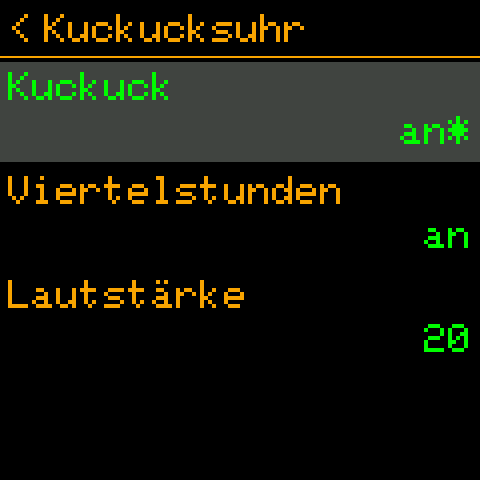

# 🐿️ Squirrel! 2.0

*[English](../en/2.0.md) · [Polski](../pl/2.0.md) · [Français](../fr/2.0.md) · Deutsch · [Alle Versionen](../README.md)*

Version 2.0 macht aus den Squirrel!-Geräten eine Familie. **Der Cardputer und die Uhr synchronisieren sich über
Bluetooth** - mit einer Taste oder von selbst nach der Uhr. Die Bildschirme sprechen **Englisch, Polnisch,
Französisch und Deutsch**. Aufgaben bekommen **Checklisten**, die Uhr des Cardputers ein Menü mit dem, was du am
häufigsten brauchst, und die Bildschirme der Uhr sind für Touch gemacht. Ein dritter, experimenteller Port läuft auf
den günstigen **ESP32-S3-Smartwatches**. Und ein Fehler, durch den "nur werktags"-Routinen am Sonntag kamen, ist weg.

 

---

## Neu

### 🔗 Bluetooth-Synchronisation

Ein Gerät des Sets ist der **Chef** - der Cardputer: er hat die Tastatur, also wird der Inhalt dort geschrieben. Die
anderen sind **Knoten** - heute die Uhr.

| Was | Richtung |
|---|---|
| der Inhalt von Routinen, Aufgaben und Notizen | Chef → Knoten |
| Haken: Aufgaben, Checklisten-Punkte, eine Routine an / aus | in beide Richtungen - die spätere Änderung gewinnt |
| das Routinen-Protokoll (erledigt / übersprungen / keine Antwort), die Statistik | Knoten → Chef, für jedes Gerät getrennt |
| Einstellungen: Kuckuck, Pomodoro, Trainingsplan, Ruhezeiten, Routinen-Pause, Auto-Sync | Chef → Knoten |
| die Uhrzeit | von der besseren Uhr zur schlechteren (WLAN-Zeit > Hardware-Uhr > von Hand gestellt) |

- **Koppeln, einmal:** die Uhr (*Einstellungen → Bluetooth*) zeigt 6 Ziffern, du gibst sie auf dem Cardputer ein
  (*Einstellungen → Bluetooth → Gerät hinzufügen*). Ein nicht gekoppeltes Gerät bekommt nichts und ändert nichts.
- **Schnell-Sync:** **Aa** auf der Uhr des Cardputers (oder *TAB, S*) synchronisiert jedes Gerät und kehrt zur Uhr
  zurück; auf der Uhr **nach unten wischen** - sie wartet auf den Cardputer und kehrt von selbst zurück.
- **Auto-Sync:** alle 15, 30, 60, 120 oder 240 Minuten, nach der Uhr (alle 60 = zu vollen Stunden), damit sich die
  Geräte treffen, ohne vorher zu reden: die Uhr wacht sogar aus dem Tiefschlaf auf und lauscht 90 s; der Cardputer
  verbindet sich 20 s danach. Etwa 1 mAh der ~380 der Uhr pro Synchronisation.
- **Die Statistik jedes Geräts** auf dem Cardputer: LEFT / RIGHT zeigt dieses Gerät, jedes synchronisierte oder alle
  zusammen.
- **Routinen auf bestimmten Geräten:** das Feld *Geräte* einer Routine.
- **Zeit von einem Gerät:** *Einstellungen → Zeit und Datum → Zeit von einem Gerät*.
- Was die Uhr hatte, bevor sie dazukam (per USB kopierte Aufgaben zum Beispiel), bleibt ihres: der Chef überschreibt
  und löscht es nicht.
- **Eine Web-Bluetooth-Seite** (`Squirrel!/tools/web/squirrel_ble.html`, Chrome / Edge) bearbeitet Aufgaben, Routinen,
  Notizen und Einstellungen über den Cardputer (*Einstellungen → Bluetooth → Sichtbar sein*), hakt ab und schaltet
  Routinen auf der Uhr und stellt die Zeit vom Handy. *Mit der Uhr ausprobiert: Verbinden, Koppeln und Lesen funktionieren; Bearbeiten von der Seite aus noch nicht ausprobiert.*

Alles darüber: [die Bluetooth-Anleitung](../../guides/de/bluetooth.md).

### 🌍 Vier Sprachen

*Einstellungen → Anpassen → Anzeige → Sprache*: English, Polski, Français, Deutsch - jeder Bildschirm, jedes Menü,
jede Einstellung und ihre Hilfe. Jede Sprache außer Englisch schaltet die Schrift mit Umlauten und Akzenten ein; die
kleine eigene Schrift der Uhr hat sie auch (ą ć ę ł ń ó ś ź ż, ä ö ü ß, é è ê à ç ...). Jede Sprache heißt in ihrer
eigenen Sprache, damit du deine findest, egal was der Bildschirm spricht.

**Einen Text, den du anders sagen würdest**, änderst du ohne neue Firmware: eine Datei `lang_<code>.tsv` im
Squirrel!-Ordner auf dem Gerät, nur mit den Zeilen, die anders sein sollen. Die Übersetzungen sind einfache
Textdateien, `Squirrel!/translations/<code>.tsv`, bereit für Verbesserungen und neue Sprachen:
[translations/README.md](../../../Squirrel!/translations/README.md).

 

### ☑️ Checklisten in Aufgaben

Eine Zeile, die mit `>` beginnt, ist ein Punkt zum Abhaken - eine Einkaufsliste, die Schritte einer Aufgabe:

```
Einkauf am Samstag
> Milch
> Brot
Tasche nicht vergessen
```

Die Aufgabenliste zeigt den Fortschritt (`[1/2]`); wenn alles abgehakt ist, ist die ganze Aufgabe erledigt.
Cardputer: OPT hakt den gewählten Punkt ab; Uhr: ein Tippen. Der Text der Datei ändert sich nie - die Haken werden
getrennt gespeichert.

### ⌨️ Die Uhr des Cardputers

- **TAB** öffnet ein kleines Menü über der Uhr: **M** Gedankenablage, **T** To-Do-Liste, **N** Textnotizen, **V**
  Sprachnotizen, **S** Schnell-Sync (TAB oder die Pfeile bewegen, ENTER öffnet, ESC schließt).
- **Aa** - Schnell-Sync. **CTRL, dann T / N** - eine neue Aufgabe / eine neue Notiz.
- Alle Tasten: [Tastenkürzel](../../guides/de/shortcuts.md).

### ⌚ Die Uhr

- Jeder Bildschirm für Touch gemacht: große Ziffern, Knöpfe *Start / Pause / Stopp* und *−* / *+*, "<" im Kopf geht
  zurück. Routinen schaltet man mit einem Tippen ein und aus.
- Unter der Uhr: **"Squirrel! is watching"**, und in Worten die heutige Fokuszeit und der Akku, jedes in der Farbe
  seines Balkens.
- Ein Tiefschlaf, aus dem sie für Routinen, den Kuckuck und Sync-Zeiten aufwacht; *Geplante Alarme* zeigt, was sie
  wecken wird.

### 🧪 Ein experimenteller Port: ESP32-S3-Smartwatches

`--port generic_s3_watch`: die Uhren, die als "ESP32-S3 smartwatch" verkauft werden (ST7789-Display, CST816-Touch,
Akku an einem ADC-Pin, ein Knopf), mit PSRAM oder ohne. Er lässt sich bauen, wurde aber noch nicht auf einer Uhr
ausprobiert: jeder Pin in seiner `port.toml` ist zum vorherigen Prüfen markiert. Siehe [Ports](../../implementation/de/ports.md).

---

## Korrekturen

- **Routinen an falschen Wochentagen (Cardputer):** seine Firmware zählt die Wochentage ab Sonntag, die App nahm
  Montag an - eine "Mo-Fr"-Routine kam am Sonntag und nicht am Freitag. Der Wochentag wird jetzt aus dem Datum
  berechnet (die Ruhezeiten und die Alarmliste auch).
- **Zufällige Neustarts des Cardputers während einer Synchronisation:** die Ereignisbehandlung des Funks behielt ein
  Tupel, das MicroPython nur für die Dauer des Aufrufs leiht.
- **Pomodoro zeigte die Anstrengungsstufen des Trainings** ("Hart", "Ruhe"); jetzt *Arbeit*, *Pause*, *Lange Pause*.
- Abgeschnittene und überlappende Texte auf mehreren Bildschirmen; die Notizansicht bricht jetzt an Leerzeichen um,
  nicht mitten im Wort.

---

## Weitere Änderungen

- **Beschriftungen:** ein Großbuchstabe nur am Anfang (*Textnotizen*, *To-Do-Liste*, *Gedankenablage*).
- **Weniger Speicher:** die Einstellungen halten keine Kopien ihrer Definitionen mehr; ein Display ohne PSRAM wird in
  Streifen gezeichnet (19 KB statt 115-134 KB) - siehe [Leistung](../../implementation/de/performance.md).
- **Ein Watchdog** startet ein Gerät neu, dessen Hauptschleife eine Minute steht (die Daten bleiben), und die Firmware
  hält einen Absturz für die Analyse fest.
- **`config.txt`:** ein in einer neuen Version geänderter Standardwert ersetzt den alten Standardwert, den eine
  frühere Version geschrieben hat, aber nie einen Wert, den du selbst gesetzt hast.
- **Routinen-Protokoll** (`focus/events.txt`): jede Routine, die kommt, endet mit einem Eintrag - erledigt,
  übersprungen oder keine Antwort; 60 Tage aufbewahrt. `routines.json`, `todo/meta.json`, `notes/meta.json` bekommen
  die Felder, die die Synchronisation braucht (von selbst ergänzt).

---

## Aktualisieren

- Bauen und flashen wie bisher: `python3 build_firmware.py --port <port> --flash PORT`
  ([Erste Schritte](../../guides/de/getting-started.md)).
- **Deine Daten bleiben**; die Dateien bekommen die neuen Felder von selbst.
- **Koppele die Uhr einmal**, um sie zu synchronisieren.
- Wenn du den Titel "Shopping list" einer Testversion benutzt hast, markiere die Punkte mit `>`.

---

## Bekannte Einschränkungen

- ⚠️ **Koppeln, aber keine Verschlüsselung.** Ohne den Code kann niemand deine Geräte synchronisieren oder ändern, aber
  die Datensätze gehen im Klartext durch die Luft: jemand in der Nähe mit Bluetooth-Abhörgerät könnte sie während
  einer Synchronisation lesen und den Schlüssel aus einer belauschten Kopplung zurückgewinnen. Koppele nicht in der
  Nähe von Fremden und halte Passwörter und sensible Daten aus synchronisierten Aufgaben und Notizen heraus. Die
  Verschlüsselung der Verbindung ist im Code, ausgeschaltet, bis sie genug getestet ist.
- **Ein seltenes Hängen des Cardputers** (etwa einmal in 70 Synchronisationen im Test): der Watchdog startet ihn nach
  einer Minute neu; die Ursache wird gesucht.
- **Manchmal "keine Antwort"** direkt nach dem Verbinden: der zweite Durchgang versucht es erneut; wenn es weiter
  scheitert, noch einmal synchronisieren.
- **Inhalt wird nur auf dem Cardputer geschrieben;** die Uhr liest und hakt ab.
- **Einen laufenden Cardputer zu flashen** scheitert oft: halte G0 beim Einstecken des Kabels.
- Die Uhr hat noch keinen Ton und keine Aufnahmen; die Beschleunigungssensoren werden nur ausgeschaltet.
- **Eine Uhr merkt sich eine Kopplung:** die Webseite mit ihr zu koppeln lässt den Cardputer bei der nächsten
  Synchronisation nach einem neuen Code fragen.

Details und wie es weitergeht: [Backlog](../../implementation/de/backlog.md).

---

## Für alle, die die Firmware bauen

- **Die Dokumentation** liegt jetzt in `docs/`: [Anleitungen](../../guides/de/) und [Implementierung](../../implementation/de/)
  in vier Sprachen; die alten Dokumente im Hauptverzeichnis des Repositorys sind weg.
- **Bluetooth:** `ble/` (`protocol.py`, `merge.py`, `peripheral.py`, `central.py`, `auth.py`, `auto.py` ...), die
  Funktionen `ble_sync` und `ble_hub` - [Entwurf](../../implementation/de/bluetooth.md), [Datenformat](../../implementation/de/data-format.md).
- **Sprachen:** `i18n.py`, `translations/`, `tools/i18n/` - [Sprachen](../../implementation/de/i18n.md).
- **Firmware-Patches** als Stapel: `firmware_patches/0001` (NimBLE-Passkey), `0002` (Absturzprotokoll).
- **Tests:** `tools/tests/` auf dem PC, das Screenshot-Szenario des Simulators, `tools/hwtest/` auf den Geräten -
  [Testen](../../implementation/de/testing.md).
