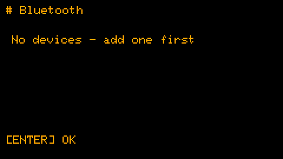
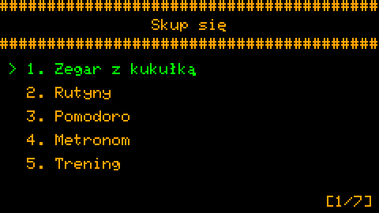

# 🐿️ Squirrel! 2.0

*[Polski](../pl/2.0.md) · [Français](../fr/2.0.md) · [Deutsch](../de/2.0.md) · [All versions](../README.md)*

Version 2.0 turns the Squirrel! devices into a family. **The Cardputer and the watch sync over Bluetooth** - with a
key, or by themselves on the clock. The screens speak **English, Polish, French and German**. To-Dos get
**checklists**, the Cardputer's clock gets a menu of the things you reach for most, and the watch's screens are made
for touch. A third, experimental port runs on the cheap **ESP32-S3 smartwatches**. And a bug that made "weekdays only"
routines fire on Sunday is gone.

 

---

## What's new

### 🔗 Bluetooth sync

One device of a set is the **boss** - the Cardputer: it has the keyboard, so content is written there. The others
are **nodes** - today the watch.

| What | Direction |
|---|---|
| the content of routines, To-Dos and notes | boss → node |
| ticks: To-Dos, checklist items, a routine on / off | both ways - the later change wins |
| the routine log (done / skipped / no answer), statistics | node → boss, kept apart for each device |
| settings: cuckoo, Pomodoro, training plan, quiet hours, routine snooze, auto sync | boss → node |
| the time | from the better clock to the worse one (Wi-Fi time > hardware clock > set by hand) |

- **Pairing, once:** the watch (*Settings → Bluetooth*) shows 6 digits, you type them on the Cardputer (*Settings →
  Bluetooth → Add device*). A device that has not paired gets nothing and changes nothing.
- **Quick sync:** **Aa** on the Cardputer's clock (or *TAB, S*) syncs every device and comes back to the clock; on the
  watch, **swipe down** on the clock - it waits for the Cardputer and comes back by itself.
- **Auto sync:** every 15, 30, 60, 120 or 240 minutes, on the clock (every 60 = at full hours), so the devices meet
  without talking first: the watch wakes even from a deep sleep and listens for 90 s; the Cardputer connects 20 s
  after the slot. About 1 mAh of the watch's ~380 per sync.
- **Statistics of every device** on the Cardputer: LEFT / RIGHT shows this device, each synced device, or all together.
- **Routines on chosen devices:** a routine's *Devices* field.
- **Time from a device:** *Settings → Time and date → Time from a device*.
- What the watch had before it joined (To-Dos copied over USB, say) stays its own: the boss neither overwrites nor
  deletes it.
- **A Web Bluetooth page** (`Squirrel!/tools/web/squirrel_ble.html`, Chrome / Edge) edits To-Dos, routines, notes and
  settings through the Cardputer (*Settings → Bluetooth → Be visible*), ticks and switches routines on the watch, and
  sets the time from a phone. *Tried with the watch: connecting, pairing and reading work; editing from the page is not yet tried.*

All about it: [the Bluetooth guide](../../guides/en/bluetooth.md).

### 🌍 Four languages

*Settings → Personalize → Display → Language*: English, Polski, Français, Deutsch - every screen, menu, setting and
its help. Any language but English turns the font with accented letters on; the watch's own small font has them too
(ą ć ę ł ń ó ś ź ż, ä ö ü ß, é è ê à ç ...). Each language is named in its own language, so you find yours whatever the
screen speaks.

**A text you would put differently** can be changed without a new firmware: a file `lang_<code>.tsv` in Squirrel!'s
folder on the device, with only the lines you want different. Translations are plain text files,
`Squirrel!/translations/<code>.tsv`, ready for improvements and new languages:
[translations/README.md](../../../Squirrel!/translations/README.md).

 

### ☑️ Checklists in To-Dos

A line that starts with `>` is an item to tick - a shopping list, the steps of a task:

```
Saturday shopping
> milk
> bread
remember the bag
```

The To-Do list shows the progress (`[1/2]`); once every item is ticked, the whole To-Do is done. Cardputer: OPT ticks
the highlighted item; watch: a tap. The text of the file never changes - the ticks are kept apart.

### ⌨️ The Cardputer's clock

- **TAB** opens a small menu over the clock: **M** Mind dump, **T** To-Do list, **N** Text notes, **V** Voice notes,
  **S** Quick sync (TAB or the arrows move, ENTER opens, ESC closes).
- **Aa** - quick sync. **CTRL, then T / N** - a new To-Do / a new note.
- All the keys: [shortcuts](../../guides/en/shortcuts.md).

### ⌚ The watch

- Every screen made for touch: big digits, *Start / Pause / Stop* and *−* / *+* buttons, "<" in the header goes back.
  Routines are switched on and off with a tap.
- Under the clock: **"Squirrel! is watching"**, and today's focus time and the battery in words, each in the colour of
  its bar.
- A deep sleep that wakes for routines, the cuckoo and sync slots; *Planned alarms* lists what will wake it.

### 🧪 An experimental port: ESP32-S3 smartwatches

`--port generic_s3_watch`: the watches sold as "ESP32-S3 smartwatch" (ST7789 display, CST816 touch, battery on an
ADC pin, one button), with PSRAM or without. It builds, but has not yet been tried on a watch: every pin in its
`port.toml` is marked to be checked first. See [ports](../../implementation/en/ports.md).

---

## Fixes

- **Routines on the wrong weekdays (Cardputer):** its firmware counts weekdays from Sunday, the app assumed Monday - a
  "Mon-Fri" routine fired on Sunday and not on Friday. The weekday is now worked out from the date (quiet hours and
  the alarm list too).
- **Random Cardputer resets during a sync:** the radio's event handler kept a tuple MicroPython lends only for the
  duration of the call.
- **Pomodoro showed Training's effort levels** ("Hard", "Rest"); now *Work*, *Break*, *Long break*.
- Cut-off and overlapping texts on several screens; the note viewer now wraps at spaces, not in the middle of a word.

---

## Other changes

- **Labels:** a capital letter only at the start (*Text notes*, *To-Do list*, *Mind dump*).
- **Less memory:** the settings keep no copies of their definitions; a display without PSRAM is drawn in strips (19 KB instead of
  115-134 KB) - see [performance](../../implementation/en/performance.md).
- **A watchdog** restarts a device whose main loop stops for a minute (data is kept), and the firmware keeps a record of
  a crash for analysis.
- **`config.txt`:** a default changed in a new version replaces the old default a previous version wrote, but never a
  value you set yourself.
- **Routine log** (`focus/events.txt`): every routine that comes up ends with an entry - done, skipped, or no answer;
  kept for 60 days. `routines.json`, `todo/meta.json`, `notes/meta.json` get the fields the sync needs (added by
  themselves).

---

## Updating

- Build and flash as before: `python3 build_firmware.py --port <port> --flash PORT`
  ([getting started](../../guides/en/getting-started.md)).
- **Your data stays**; the files get the new fields by themselves.
- **Pair the watch once** to sync it.
- If you used a test version's "Shopping list" title, mark the items with `>`.

---

## Known limitations

- ⚠️ **Pairing, but no encryption.** Without the code nobody can sync or change your devices, but the records go over
  the air in the clear: someone nearby with Bluetooth sniffing gear could read them during a sync, and recover the
  key from an overheard pairing. Pair away from strangers and keep passwords and sensitive data out of synced To-Dos
  and notes. Link encryption is in the code, switched off until it has been tested enough.
- **A rare Cardputer freeze** (about once in 70 syncs in testing): the watchdog restarts it after a minute; the cause
  is being looked for.
- **Sometimes "no answer"** right after connecting: the second round retries; if it still fails, sync again.
- **Content is written on the Cardputer only;** the watch reads and ticks.
- **Flashing a running Cardputer** often fails: hold G0 while plugging the cable in.
- The watch has no sound or recordings yet; the accelerometers are only switched off.
- **A watch remembers one pairing:** pairing the web page with it makes the Cardputer ask for a new code at its
  next sync.

Details and what comes next: [backlog](../../implementation/en/backlog.md).

---

## For those who build the firmware

- **Docs** are now in `docs/`: [guides](../../guides/en/) and [implementation](../../implementation/en/) in four
  languages; the old documents in the repository's root are gone.
- **Bluetooth:** `ble/` (`protocol.py`, `merge.py`, `peripheral.py`, `central.py`, `auth.py`, `auto.py` ...), features
  `ble_sync` and `ble_hub` - [design](../../implementation/en/bluetooth.md), [data format](../../implementation/en/data-format.md).
- **Languages:** `i18n.py`, `translations/`, `tools/i18n/` - [i18n](../../implementation/en/i18n.md).
- **Firmware patches** as a stack: `firmware_patches/0001` (NimBLE passkey), `0002` (panic record).
- **Tests:** `tools/tests/` on the PC, the simulator's screenshot scenario, `tools/hwtest/` on the devices -
  [testing](../../implementation/en/testing.md).
