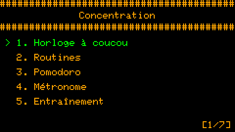
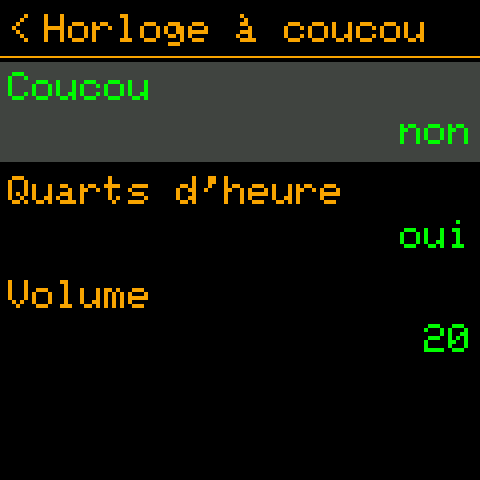

# 🐿️ Squirrel! 2.0

*[English](../en/2.0.md) · [Polski](../pl/2.0.md) · Français · [Deutsch](../de/2.0.md) · [Toutes les versions](../README.md)*

La version 2.0 fait des appareils Squirrel! une famille. **Le Cardputer et la montre se synchronisent par
Bluetooth** - d'une touche, ou d'eux-mêmes selon l'horloge. Les écrans parlent **anglais, polonais, français et
allemand**. Les tâches gagnent des **listes à cocher**, l'horloge du Cardputer un menu de ce dont tu te sers le plus,
et les écrans de la montre sont faits pour le toucher. Un troisième port, expérimental, tourne sur les **montres
ESP32-S3** bon marché. Et un bug qui faisait sonner les routines "jours de semaine" le dimanche a disparu.

 

---

## Nouveautés

### 🔗 Synchronisation Bluetooth

Un appareil de l'ensemble est le **chef** - le Cardputer : il a le clavier, c'est donc là qu'on écrit le contenu. Les
autres sont des **nœuds** - aujourd'hui la montre.

| Quoi | Sens |
|---|---|
| le contenu des routines, tâches et notes | chef → nœud |
| les coches : tâches, éléments de listes, une routine activée / désactivée | dans les deux sens - le changement le plus récent gagne |
| le journal des routines (fait / passé / pas de réponse), les statistiques | nœud → chef, gardés à part pour chaque appareil |
| les réglages : coucou, Pomodoro, plan d'entraînement, heures de silence, report des routines, synchro auto | chef → nœud |
| l'heure | de la meilleure horloge vers la moins bonne (heure Wi-Fi > horloge matérielle > réglée à la main) |

- **Appairage, une fois :** la montre (*Réglages → Bluetooth*) affiche 6 chiffres, tu les tapes sur le Cardputer
  (*Réglages → Bluetooth → Ajouter un appareil*). Un appareil non appairé ne reçoit rien et ne change rien.
- **Synchro rapide :** **Aa** sur l'horloge du Cardputer (ou *TAB, S*) synchronise chaque appareil et revient à
  l'horloge ; sur la montre, **glisser vers le bas** sur l'horloge - elle attend le Cardputer et revient d'elle-même.
- **Synchro auto :** toutes les 15, 30, 60, 120 ou 240 minutes, selon l'horloge (toutes les 60 = aux heures pile), pour
  que les appareils se retrouvent sans se parler avant : la montre se réveille même d'un sommeil profond et écoute
  90 s ; le Cardputer se connecte 20 s après. Environ 1 mAh des ~380 de la montre par synchronisation.
- **Les statistiques de chaque appareil** sur le Cardputer : LEFT / RIGHT montre cet appareil, chaque appareil
  synchronisé, ou tous ensemble.
- **Des routines sur certains appareils :** le champ *Appareils* d'une routine.
- **L'heure d'un appareil :** *Réglages → Heure et date → Heure d'un appareil*.
- Ce que la montre avait avant de rejoindre l'ensemble (des tâches copiées par USB, par exemple) reste à elle : le
  chef ne l'écrase ni ne le supprime.
- **Une page Web Bluetooth** (`Squirrel!/tools/web/squirrel_ble.html`, Chrome / Edge) modifie tâches, routines, notes
  et réglages via le Cardputer (*Réglages → Bluetooth → Être visible*), coche et active les routines sur la montre, et
  règle l'heure depuis un téléphone. *Essayée avec la montre : connexion, appairage et lecture marchent ; la modification depuis la page n'est pas encore essayée.*

Tout à ce sujet : [le guide Bluetooth](../../guides/fr/bluetooth.md).

### 🌍 Quatre langues

*Réglages → Personnaliser → Écran → Langue* : English, Polski, Français, Deutsch - chaque écran, menu, réglage et son
aide. Toute langue autre que l'anglais active la police avec les lettres accentuées ; la petite police de la montre les
a aussi (ą ć ę ł ń ó ś ź ż, ä ö ü ß, é è ê à ç ...). Chaque langue est nommée dans sa propre langue, pour que tu
trouves la tienne quelle que soit celle de l'écran.

**Un texte que tu formulerais autrement** se change sans nouveau firmware : un fichier `lang_<code>.tsv` dans le
dossier de Squirrel! sur l'appareil, avec seulement les lignes que tu veux différentes. Les traductions sont de
simples fichiers texte, `Squirrel!/translations/<code>.tsv`, prêts pour des améliorations et de nouvelles langues :
[translations/README.md](../../../Squirrel!/translations/README.md).

 

### ☑️ Listes à cocher dans les tâches

Une ligne qui commence par `>` est un élément à cocher - une liste de courses, les étapes d'une tâche :

```
Courses du samedi
> lait
> pain
ne pas oublier le sac
```

La liste des tâches montre l'avancement (`[1/2]`) ; quand tout est coché, la tâche entière est faite. Cardputer : OPT
coche l'élément en surbrillance ; montre : un toucher. Le texte du fichier ne change jamais - les coches sont gardées à
part.

### ⌨️ L'horloge du Cardputer

- **TAB** ouvre un petit menu par-dessus l'horloge : **M** Vide-tête, **T** Liste To-Do, **N** Notes texte, **V** Notes
  vocales, **S** Synchro rapide (TAB ou les flèches déplacent, ENTER ouvre, ESC ferme).
- **Aa** - synchro rapide. **CTRL, puis T / N** - une nouvelle tâche / une nouvelle note.
- Toutes les touches : [raccourcis](../../guides/fr/shortcuts.md).

### ⌚ La montre

- Chaque écran fait pour le toucher : de grands chiffres, des boutons *Démarrer / Pause / Arrêter* et *−* / *+*, "<"
  dans l'en-tête pour revenir. Les routines s'activent et se désactivent d'un toucher.
- Sous l'horloge : **"Squirrel! is watching"**, et en mots le temps de concentration du jour et la batterie, chacun
  dans la couleur de sa barre.
- Un sommeil profond dont elle sort pour les routines, le coucou et les heures de synchronisation ; *Alarmes prévues*
  montre ce qui la réveillera.

### 🧪 Un port expérimental : les montres ESP32-S3

`--port generic_s3_watch` : les montres vendues comme "ESP32-S3 smartwatch" (écran ST7789, tactile CST816, batterie sur
une broche ADC, un bouton), avec ou sans PSRAM. Il se compile, mais n'a pas encore été essayé sur une montre : chaque
broche de son `port.toml` est marquée à vérifier d'abord. Voir [ports](../../implementation/fr/ports.md).

---

## Corrections

- **Routines les mauvais jours (Cardputer) :** son firmware compte les jours à partir du dimanche, l'application
  supposait le lundi - une routine "lun-ven" sonnait le dimanche et pas le vendredi. Le jour de la semaine est
  désormais calculé à partir de la date (les heures de silence et la liste des alarmes aussi).
- **Réinitialisations aléatoires du Cardputer pendant une synchronisation :** le gestionnaire d'événements radio
  gardait un tuple que MicroPython ne prête que le temps de l'appel.
- **Le Pomodoro affichait les niveaux d'effort de l'Entraînement** ("Intense", "Repos") ; maintenant *Travail*,
  *Pause*, *Longue pause*.
- Des textes coupés ou qui se chevauchaient sur plusieurs écrans ; la lecture d'une note revient à la ligne sur les
  espaces, plus au milieu d'un mot.

---

## Autres changements

- **Libellés :** une majuscule seulement au début (*Notes texte*, *Liste To-Do*, *Vide-tête*).
- **Moins de mémoire :** les réglages ne gardent plus de copies de leurs définitions ; un écran sans PSRAM est dessiné
  par bandes (19 Ko au lieu de 115-134 Ko) - voir [performances](../../implementation/fr/performance.md).
- **Un chien de garde** redémarre un appareil dont la boucle principale s'arrête une minute (les données restent), et
  le firmware garde une trace du plantage pour l'analyse.
- **`config.txt` :** une valeur par défaut changée dans une nouvelle version remplace l'ancienne valeur par défaut
  écrite par une version précédente, mais jamais une valeur que tu as réglée toi-même.
- **Journal des routines** (`focus/events.txt`) : chaque routine qui se présente se termine par une entrée - faite,
  passée ou sans réponse ; gardé 60 jours. `routines.json`, `todo/meta.json`, `notes/meta.json` reçoivent les champs
  dont la synchronisation a besoin (ajoutés d'eux-mêmes).

---

## Mettre à jour

- Compiler et flasher comme avant : `python3 build_firmware.py --port <port> --flash PORT`
  ([premiers pas](../../guides/fr/getting-started.md)).
- **Tes données restent** ; les fichiers reçoivent les nouveaux champs d'eux-mêmes.
- **Appaire la montre une fois** pour la synchroniser.
- Si tu utilisais le titre "Shopping list" d'une version de test, marque les éléments avec `>`.

---

## Limites connues

- ⚠️ **Appairage, mais sans chiffrement.** Sans le code, personne ne peut synchroniser ni modifier tes appareils, mais
  les enregistrements passent dans les airs en clair : quelqu'un à proximité avec du matériel d'écoute Bluetooth
  pourrait les lire pendant une synchronisation, et retrouver la clé à partir d'un appairage intercepté. Appaire loin
  des inconnus et garde mots de passe et données sensibles hors des tâches et notes synchronisées. Le chiffrement de
  la liaison est dans le code, désactivé tant qu'il n'a pas été assez testé.
- **Un blocage rare du Cardputer** (environ une fois sur 70 synchronisations en test) : le chien de garde le redémarre
  au bout d'une minute ; la cause est recherchée.
- **Parfois "pas de réponse"** juste après la connexion : la deuxième passe réessaie ; si ça échoue encore,
  resynchronise.
- **Le contenu ne s'écrit que sur le Cardputer ;** la montre lit et coche.
- **Flasher un Cardputer en marche** échoue souvent : maintiens G0 en branchant le câble.
- La montre n'a pas encore de son ni d'enregistrements ; les accéléromètres sont seulement éteints.
- **Une montre retient un seul appairage :** appairer la page web avec elle fait demander un nouveau code au
  Cardputer à sa prochaine synchronisation.

Détails et suite : [backlog](../../implementation/fr/backlog.md).

---

## Pour ceux qui compilent le firmware

- **La documentation** est maintenant dans `docs/` : [guides](../../guides/fr/) et [implémentation](../../implementation/fr/)
  en quatre langues ; les anciens documents à la racine du dépôt ont disparu.
- **Bluetooth :** `ble/` (`protocol.py`, `merge.py`, `peripheral.py`, `central.py`, `auth.py`, `auto.py` ...), les
  fonctions `ble_sync` et `ble_hub` - [conception](../../implementation/fr/bluetooth.md), [format des données](../../implementation/fr/data-format.md).
- **Langues :** `i18n.py`, `translations/`, `tools/i18n/` - [langues](../../implementation/fr/i18n.md).
- **Correctifs du firmware** en pile : `firmware_patches/0001` (passkey NimBLE), `0002` (trace de plantage).
- **Tests :** `tools/tests/` sur le PC, le scénario de captures du simulateur, `tools/hwtest/` sur les appareils -
  [tests](../../implementation/fr/testing.md).
