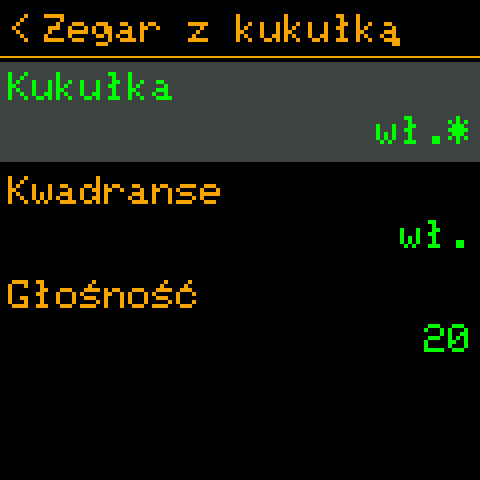

# 🐿️ Squirrel! 2.0

*[English](../en/2.0.md) · Polski · [Français](../fr/2.0.md) · [Deutsch](../de/2.0.md) · [Wszystkie wersje](../README.md)*

Wersja 2.0 robi z urządzeń Squirrel! rodzinę. **Cardputer i zegarek synchronizują się przez Bluetooth** - jednym
klawiszem albo same, według zegara. Ekrany mówią **po angielsku, polsku, francusku i niemiecku**. Zadania dostają
**checklisty**, zegar Cardputera - menu tego, po co sięgasz najczęściej, a ekrany zegarka są zrobione pod dotyk.
Trzeci, eksperymentalny port działa na tanich **smartwatchach z ESP32-S3**. A błąd, przez który rutyny "tylko w dni
robocze" odzywały się w niedzielę, zniknął.

 

---

## Co nowego

### 🔗 Synchronizacja Bluetooth

Jedno urządzenie w zestawie jest **szefem** - Cardputer: ma klawiaturę, więc tam powstaje treść. Pozostałe to
**nody** - dziś zegarek.

| Co | Kierunek |
|---|---|
| treść rutyn, zadań i notatek | szef → node |
| odhaczenia: zadania, punkty checklist, rutyna wł. / wył. | w obie strony - wygrywa późniejsza zmiana |
| log rutyn (zrobione / pominięte / bez odpowiedzi), statystyki | node → szef, osobno dla każdego urządzenia |
| ustawienia: kukułka, Pomodoro, plan treningu, godziny ciszy, drzemka rutyn, auto-synchronizacja | szef → node |
| czas | z lepszego zegara do gorszego (czas z Wi-Fi > zegar sprzętowy > ustawiony ręcznie) |

- **Parowanie, raz:** zegarek (*Ustawienia → Bluetooth*) pokazuje 6 cyfr, wpisujesz je na Cardputerze (*Ustawienia →
  Bluetooth → Dodaj urządzenie*). Urządzenie niesparowane niczego nie dostaje i niczego nie zmienia.
- **Szybka synchronizacja:** **Aa** na zegarze Cardputera (albo *TAB, S*) synchronizuje każde urządzenie i wraca na
  zegar; na zegarku **przesunięcie w dół** na zegarze - czeka na Cardputera i sam wraca.
- **Auto-synchronizacja:** co 15, 30, 60, 120 albo 240 minut, według zegara (co 60 = o pełnych godzinach), więc
  urządzenia spotykają się bez wcześniejszej rozmowy: zegarek budzi się nawet z głębokiego snu i nasłuchuje 90 s;
  Cardputer łączy się 20 s po czasie. Około 1 mAh z ~380 baterii zegarka na synchronizację.
- **Statystyki każdego urządzenia** na Cardputerze: LEFT / RIGHT pokazuje to urządzenie, każde zsynchronizowane albo
  wszystkie razem.
- **Rutyny na wybranych urządzeniach:** pole *Urządzenia* w rutynie.
- **Czas z urządzenia:** *Ustawienia → Czas i data → Czas z urządzenia*.
- To, co zegarek miał przed dołączeniem (na przykład zadania skopiowane przez USB), zostaje jego: szef ani tego nie
  nadpisuje, ani nie usuwa.
- **Strona Web Bluetooth** (`Squirrel!/tools/web/squirrel_ble.html`, Chrome / Edge) edytuje zadania, rutyny, notatki i
  ustawienia przez Cardputera (*Ustawienia → Bluetooth → Bądź widoczny*), odhacza i przełącza rutyny na zegarku i
  ustawia czas z telefonu. *Sprawdzona z zegarkiem: łączenie, parowanie i odczyt działają; edycji ze strony jeszcze nie sprawdzano.*

Wszystko o tym: [przewodnik po synchronizacji](../../guides/pl/bluetooth.md).

### 🌍 Cztery języki

*Ustawienia → Personalizacja → Ekran → Język*: English, Polski, Français, Deutsch - każdy ekran, menu, ustawienie i
jego pomoc. Każdy język poza angielskim włącza czcionkę z literami diakrytycznymi; własna mała czcionka zegarka też je
ma (ą ć ę ł ń ó ś ź ż, ä ö ü ß, é è ê à ç ...). Każdy język nazywa się w swoim własnym języku, więc znajdziesz swój,
czymkolwiek mówi ekran.

**Tekst, który ująłbyś inaczej**, zmienisz bez nowego firmware: plik `lang_<kod>.tsv` w folderze Squirrel! na
urządzeniu, tylko z liniami, które chcesz mieć inaczej. Tłumaczenia to zwykłe pliki tekstowe,
`Squirrel!/translations/<kod>.tsv`, gotowe na poprawki i nowe języki:
[translations/README.md](../../../Squirrel!/translations/README.md).

 

### ☑️ Checklisty w zadaniach

Linia zaczynająca się od `>` to punkt do odhaczenia - lista zakupów, kroki zadania:

```
Zakupy na sobotę
> mleko
> chleb
pamiętaj o torbie
```

Lista zadań pokazuje postęp (`[1/2]`); gdy wszystko jest odhaczone, całe zadanie jest zrobione. Cardputer: OPT odhacza
zaznaczony punkt; zegarek: stuknięcie. Tekst pliku nigdy się nie zmienia - odhaczenia są trzymane osobno.

### ⌨️ Zegar Cardputera

- **TAB** otwiera małe menu nad zegarem: **M** Mind dump, **T** Lista To-Do, **N** Notatki tekstowe, **V** Notatki
  głosowe, **S** Szybka synchronizacja (TAB albo strzałki przesuwają, ENTER otwiera, ESC zamyka).
- **Aa** - szybka synchronizacja. **CTRL, potem T / N** - nowe zadanie / nowa notatka.
- Wszystkie klawisze: [skróty](../../guides/pl/shortcuts.md).

### ⌚ Zegarek

- Każdy ekran zrobiony pod dotyk: duże cyfry, przyciski *Start / Pauza / Stop* i *−* / *+*, "<" w nagłówku cofa.
  Rutyny włącza się i wyłącza stuknięciem.
- Pod zegarem: **"Squirrel! is watching"** oraz, słowami, dzisiejszy czas skupienia i bateria, każde w kolorze swojej
  belki.
- Głęboki sen, z którego budzi się na rutyny, kukułkę i pory synchronizacji; *Planowane alarmy* pokazują, co go
  obudzi.

### 🧪 Eksperymentalny port: smartwatche z ESP32-S3

`--port generic_s3_watch`: zegarki sprzedawane jako "ESP32-S3 smartwatch" (ekran ST7789, dotyk CST816, bateria na
pinie ADC, jeden przycisk), z PSRAM albo bez. Buduje się, ale nie był jeszcze sprawdzony na zegarku: każdy pin w jego
`port.toml` jest oznaczony do sprawdzenia. Zobacz [porty](../../implementation/pl/ports.md).

---

## Poprawki

- **Rutyny w złe dni tygodnia (Cardputer):** jego firmware liczy dni od niedzieli, aplikacja zakładała poniedziałek -
  rutyna "pn-pt" odzywała się w niedzielę, a w piątek nie. Dzień tygodnia jest teraz liczony z daty (godziny ciszy i
  lista alarmów też).
- **Losowe resety Cardputera w trakcie synchronizacji:** obsługa zdarzeń radia trzymała krotkę, którą MicroPython
  pożycza tylko na czas wywołania.
- **Pomodoro pokazywało poziomy wysiłku z Treningu** ("Mocno", "Odpoczynek"); teraz *Praca*, *Przerwa*, *Długa
  przerwa*.
- Ucięte i nachodzące na siebie teksty na kilku ekranach; podgląd notatki zawija teraz wiersze na spacjach, a nie w
  środku słowa.

---

## Inne zmiany

- **Etykiety:** wielka litera tylko na początku (*Notatki tekstowe*, *Lista To-Do*, *Mind dump*).
- **Mniej pamięci:** ustawienia nie trzymają kopii swoich definicji; ekran bez PSRAM jest rysowany pasami (19 KB
  zamiast 115-134 KB) - zobacz [wydajność](../../implementation/pl/performance.md).
- **Watchdog** restartuje urządzenie, którego pętla główna stanęła na minutę (dane zostają), a firmware zachowuje zapis
  awarii do analizy.
- **`config.txt`:** wartość domyślna zmieniona w nowej wersji zastępuje starą wartość domyślną zapisaną przez
  poprzednią wersję, ale nigdy wartości ustawionej przez Ciebie.
- **Log rutyn** (`focus/events.txt`): każda rutyna, która się pojawi, kończy się wpisem - zrobione, pominięte albo bez
  odpowiedzi; trzymany 60 dni. `routines.json`, `todo/meta.json`, `notes/meta.json` dostają pola potrzebne do
  synchronizacji (dodawane same).

---

## Aktualizacja

- Budowanie i wgrywanie jak dotąd: `python3 build_firmware.py --port <port> --flash PORT`
  ([pierwsze kroki](../../guides/pl/getting-started.md)).
- **Twoje dane zostają**; pliki same dostają nowe pola.
- **Sparuj zegarek raz**, żeby go synchronizować.
- Jeśli używałeś tytułu "Lista zakupów" z wersji testowej, oznacz punkty znakiem `>`.

---

## Znane ograniczenia

- ⚠️ **Parowanie, ale bez szyfrowania.** Bez kodu nikt nie zsynchronizuje ani nie zmieni Twoich urządzeń, ale rekordy
  idą w powietrzu otwartym tekstem: ktoś w pobliżu ze sprzętem do podsłuchu Bluetooth mógłby je przeczytać w trakcie
  synchronizacji i odtworzyć klucz z podsłuchanego parowania. Paruj z dala od obcych i nie trzymaj haseł ani danych
  wrażliwych w synchronizowanych zadaniach i notatkach. Szyfrowanie łącza jest w kodzie, wyłączone do czasu, aż będzie
  dość sprawdzone.
- **Rzadkie zawieszenie Cardputera** (mniej więcej raz na 70 synchronizacji w testach): watchdog restartuje go po
  minucie; przyczyna jest szukana.
- **Czasem "brak odpowiedzi"** tuż po połączeniu: druga runda ponawia próbę; jeśli dalej nie wychodzi, zsynchronizuj
  jeszcze raz.
- **Treść pisze się tylko na Cardputerze;** zegarek czyta i odhacza.
- **Wgrywanie działającego Cardputera** często się nie udaje: przytrzymaj G0 przy podłączaniu kabla.
- Zegarek nie ma jeszcze dźwięku ani nagrań; akcelerometry są tylko wyłączane.
- **Zegarek pamięta jedno parowanie:** sparowanie z nim strony www sprawia, że Cardputer przy następnej
  synchronizacji poprosi o nowy kod.

Szczegóły i co dalej: [backlog](../../implementation/pl/backlog.md).

---

## Dla tych, którzy budują firmware

- **Dokumentacja** jest teraz w `docs/`: [przewodniki](../../guides/pl/) i [implementacja](../../implementation/pl/)
  w czterech językach; stare dokumenty z katalogu głównego repozytorium zniknęły.
- **Bluetooth:** `ble/` (`protocol.py`, `merge.py`, `peripheral.py`, `central.py`, `auth.py`, `auto.py` ...), funkcje
  `ble_sync` i `ble_hub` - [projekt](../../implementation/pl/bluetooth.md), [format danych](../../implementation/pl/data-format.md).
- **Języki:** `i18n.py`, `translations/`, `tools/i18n/` - [języki](../../implementation/pl/i18n.md).
- **Łatki firmware** jako stos: `firmware_patches/0001` (passkey NimBLE), `0002` (zapis awarii).
- **Testy:** `tools/tests/` na PC, scenariusz zrzutów ekranu w symulatorze, `tools/hwtest/` na urządzeniach -
  [testowanie](../../implementation/pl/testing.md).
